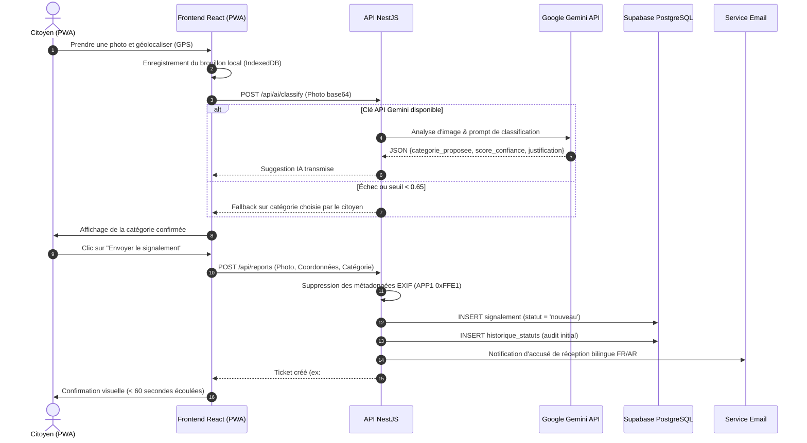
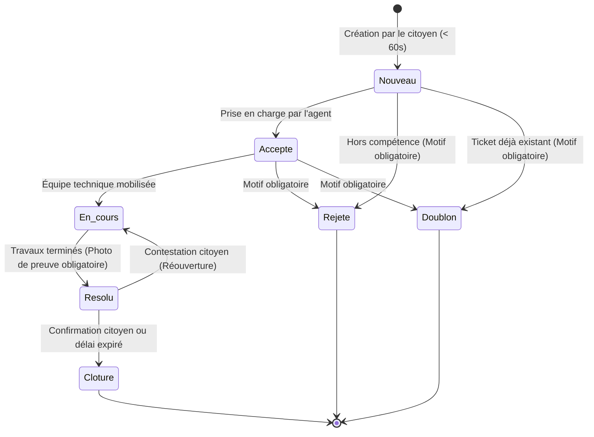
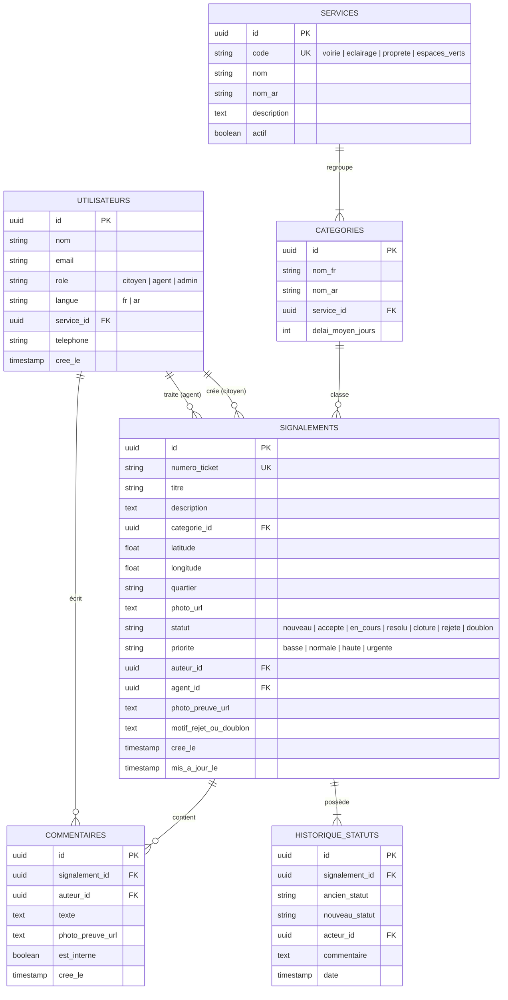

# Architecture Technique Globale — Kalaa Connect
## Plateforme Cloud de Signalement Urbain (Kalâa Seghira)

Ce document décrit en détail l'architecture logicielle, les flux de données, la sécurité et la modélisation conceptuelle de la plateforme **Kalaa Connect**.

---

## 1. Vue d'Ensemble des Composants (C4 Model)

```mermaid
flowchart TD
    subgraph Clients["Clients Utilisateurs"]
        CitoyenMobile["Citoyen (Smartphone / PWA)"]
        AgentDesk["Agent Municipal & Admin (Navigateur)"]
    end

    subgraph Edge["Distribution & CDN"]
        CFPages["Cloudflare Pages (Hébergement PWA statique)"]
    end

    subgraph CloudRun["Google Cloud Platform (Région europe-west1)"]
        API["API NestJS (Conteneur Docker Cloud Run)<br/>Scale-to-zero (Max 2 instances)"]
        SecretMgr["Secret Manager (Gestion des clés)"]
        ArtifactReg["Artifact Registry (Dépôt d'images)"]
    end

    subgraph ManagedServices["Services Cloud Gérés (Palier Gratuit)"]
        SupaAuth["Supabase Auth (Authentification JWT)"]
        SupaDB[("Supabase PostgreSQL (Tables & Règles RLS)")]
        SupaStore["Supabase Storage (Photos anonymisées)"]
        GeminiAPI["Google Gemini 1.5 Flash (Classification IA)"]
        ResendMail["Resend / Brevo (Emails bilingues)"]
    end

    subgraph Observability["Supervision & Monitoring"]
        Grafana["Grafana Cloud (Métriques & Alertes)"]
        Uptime["GitHub Actions Cron (Ping Anti-Pause & Backup SQL)"]
    end

    CitoyenMobile -->|HTTPS / PWA| CFPages
    AgentDesk -->|HTTPS / SPA| CFPages
    CFPages -->|API REST / JWT| API

    API -->|Validation Token| SupaAuth
    API -->|Requêtes SQL / RLS| SupaDB
    API -->|Upload sans EXIF| SupaStore
    API -->|Vision Artificielle| GeminiAPI
    API -->|Notifications transactionnelles| ResendMail

    API -->|Métriques Prometheus| Grafana
    Uptime -->|/health (toutes les 72h)| API
    SecretMgr -.->|Injection variables| API
```

---

## 2. Diagramme de Séquence : Signalement Citoyen et Classification IA



---

## 3. Machine à États Finis : Cycle de Vie des Tickets



---

## 4. Modèle Entité-Association (ERD) de la Base de Données



---

## 5. Analyse des Coûts Cloud : Respect du Budget 0 TND

| Composant | Fournisseur | Limite du Palier Gratuit | Consommation Estimée Kalaa Connect | Coût Mensuel Réel |
| :--- | :--- | :--- | :--- | :--- |
| **API Backend** | Google Cloud Run | 2 millions de requêtes / mois, 360 000 vCPU-sec | ~15 000 requêtes / mois (pilote municipal) | **0,00 TND** |
| **Dépôt d'Images** | Google Artifact Registry | 500 Mo gratuits de stockage conteneur | Image Alpine compressée : 82 Mo | **0,00 TND** |
| **Base de Données** | Supabase PostgreSQL | 500 Mo de base, 2 Go de transfert | Base de données optimisée : < 50 Mo | **0,00 TND** |
| **Stockage Médias** | Supabase Storage | 1 Go gratuit | Photos compressées (max 1 Mo) avec purge : < 400 Mo | **0,00 TND** |
| **Frontend PWA** | Cloudflare Pages | Requêtes et bande passante illimitées | Hébergement statique optimisé | **0,00 TND** |
| **Vision IA** | Google Gemini API | 15 requêtes par minute (Free tier) | ~10 à 20 signalements par jour | **0,00 TND** |
| **Emails** | Resend / Brevo | 100 à 300 emails par jour gratuits | ~30 emails de notification par jour | **0,00 TND** |
| **Supervision** | Grafana Cloud | 10 000 séries temporelles, 50 Go logs | 1 service Cloud Run : < 300 séries | **0,00 TND** |
| **TOTAL** | — | — | **0 TND / mois garanti** | **0,00 TND** |
