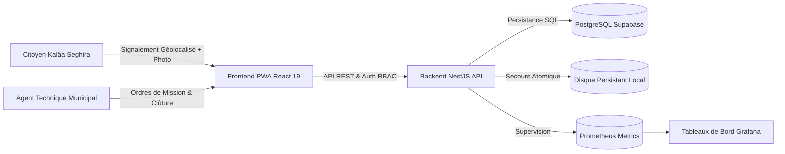

# Kalaa Connect — Plateforme Cloud Municipale de Kalâa Seghira

**Plateforme Cloud Intelligente de Signalement Citoyen et de Gestion Territoriale**  
*Projet de Stage Ingénieur 2ème Année — ESPRIT (École Supérieure Privée d'Ingénierie et de Technologies)*  
*Année Universitaire : 2025–2026*  

- **Étudiante-Ingénieure** : **Nada SLAMA**  
- **Encadrante Professionnelle** : **Mme Dalila KHLIFA** (Municipalité de Kalâa Seghira, Gouvernorat de Sousse)  
- **Établissement** : ESPRIT  
- **Organisation d'Accueil** : Municipalité de Kalâa Seghira  

---

## 🏛️ 1. Présentation du Projet

**Kalaa Connect** est une solution cloud moderne et inclusive conçue pour digitaliser la relation citoyen-collectivité au sein de la **Municipalité de Kalâa Seghira**. La plateforme permet aux habitants de signaler en temps réel des dégradations urbaines (voirie, éclairage défectueux, dépôts sauvages d'ordures, espaces verts) et dote les services techniques municipaux d'un outil d'ordonnancement, de gestion d'interventions et de pilotage territorial par la donnée.



---

## 🚀 2. Démarrage Rapide

### Prérequis
- Node.js 20+ et npm
- Docker et Docker Compose (optionnel pour la pile complète)
- Navigateur moderne (Edge, Chrome, Firefox)

### Lancement en Développement Local
```bash
# 1. Cloner le dépôt
git clone https://github.com/Imed-attia/kalaa-connect.git
cd kalaa-connect

# 2. Installer les dépendances
npm install

# 3. Lancer l'API NestJS (port 3000) et le Frontend React Vite (port 5173)
npm run dev
```

### Lancement via Docker Compose (Pile Complète)
```bash
docker compose up -d --build
```
Services disponibles :
- **Frontend Web** : `http://localhost:5173` (ou `http://localhost:80` en conteneur)
- **API NestJS** : `http://localhost:3000/api`
- **Sonde de Santé** : `http://localhost:3000/api/health/ready`
- **Métriques Prometheus** : `http://localhost:3000/api/metrics`
- **Serveur Prometheus** : `http://localhost:9090`
- **Tableaux de bord Grafana** : `http://localhost:3001`

---

## 🧪 3. Tests & Assurance Qualité (QA)

Le projet intègre une suite de tests rigoureuse couvrant les tests unitaires, d'intégration et les tests d'interface réels sur navigateur :

```bash
# Exécution de la suite de tests automatisés (31/31 PASS)
npm test

# Exécution des tests E2E réels sur navigateur Edge Chromium (avec capture d'écran)
node scripts/e2e-browser-test.js
```

### Synthèse des Tests Navigateur E2E :
| N° | Scénario Utilisateur | Statut | Preuve Capturée |
| :---: | :--- | :---: | :--- |
| 1 | Chargement Page Accueil & Carte | **PASS** | `docs/screenshots/01_homepage.png` |
| 2 | Affichage Formulaire Signalement | **PASS** | `docs/screenshots/02_report_form.png` |
| 3 | Saisie et Validation Formulaire | **PASS** | `docs/screenshots/03_form_filled.png` |
| 4 | Espace Mes Signalements | **PASS** | `docs/screenshots/04_my_reports.png` |
| 5 | Modification & Sauvegarde (Fix Defect) | **PASS** | `docs/screenshots/05_edit_saved.png` |
| 6 | Vérification Persistance après Rechargement (F5) | **PASS** | `docs/screenshots/06_persisted_after_refresh.png` |
| 7 | Espace Agent Municipal & Ordres de Mission | **PASS** | `docs/screenshots/07_agent_dashboard.png` |
| 8 | Adaptabilité Mobile & PWA Responsive | **PASS** | `docs/screenshots/08_mobile_responsive.png` |

---

## 📚 4. Dossier Technique Complet (`docs/`)

Retrouvez les spécifications d'ingénierie détaillées dans la documentation du projet :

- [Architecture Système](docs/ARCHITECTURE.md) : Découpage modulaire NestJS, flux de données, composants.
- [Architecture Cloud](docs/CLOUD_ARCHITECTURE.md) : Modèle multi-cloud hybride, Vercel Edge, conteneurs, PRA/PCA.
- [Pipeline CI/CD](docs/CI_CD.md) : Workflows GitHub Actions, CodeQL, SonarQube, builds déterministes.
- [Sécurité & RBAC](docs/SECURITY.md) : Modèle STRIDE, hachage des mots de passe, JWT, protection CSRF/XSS.
- [Monitoring & Observabilité](docs/MONITORING.md) : Métriques Prometheus, dashboards Grafana, alertes SLI/SLO.
- [Sondes de Santé](docs/HEALTH_CHECKS.md) : Sondes Liveness, Readiness, Kubernetes & Docker probes.
- [Base de Données](docs/DATABASE.md) : Investigation du write path, analyse de cause racine du bug d'écriture, schéma SQL.
- [Déploiement en Production](docs/DEPLOYMENT.md) : Guide de mise en ligne Vercel, Docker, matrice des variables d'environnement.
- [Runbook Opérationnel](docs/OPERATIONS_RUNBOOK.md) : Procédures de maintenance, sauvegardes, résolutions d'incidents, rollbacks.
- [Inventaire des Outils](docs/TOOLS_INVENTORY.md) : Catalogue exhaustif des 19 outils et technologies utilisés.
- [Analyse des Coûts & Compromis](docs/COSTS_AND_TRADEOFFS.md) : Budget TCO (0$ pilote, 50$/mois production), arbitrages d'ingénierie.
- [Rapport de Tests](docs/TESTING.md) : Résultats des tests E2E avec journal d'exécution.

---

## 👥 5. Comptes de Démonstration & Profils de Test

| Rôle | Nom | Identifiant | Droits & Accès |
| :--- | :--- | :--- | :--- |
| **Citoyenne** | Nada SLAMA | `usr-citoyen-nada` | Création et suivi de ses signalements personnels |
| **Administratrice** | Mme Dalila KHLIFA | `usr-admin-dalila` | Supervision municipale globale, gestion des agents, paramétrage |
| **Agent de Terrain** | Ali Mansour | `usr-agent-ali` | Prise en charge des interventions (Voirie & Propreté) |
| **Superviseure** | Salma Ben Amor | `usr-superviseur-salma` | Affectation des équipes et validation des clôtures de tickets |

---

## 📄 6. Livrables Académiques

- **Rapport de Stage 2ème Année** : `RAPPORT_STAGE_2EME_ANNEE_NADA_SLAMA.pdf` & `.docx`
- **Journal de Stage Rempli** : `journal_stage_4_fr_rempli.pdf` (J1 à J45+)
- **Présentation de Soutenance Canva** : Projet Canva interactif (20 diapositives, charte graphique ESPRIT et Kalâa Seghira).

*Conçu et développé avec rigueur pour la Municipalité de Kalâa Seghira.*
