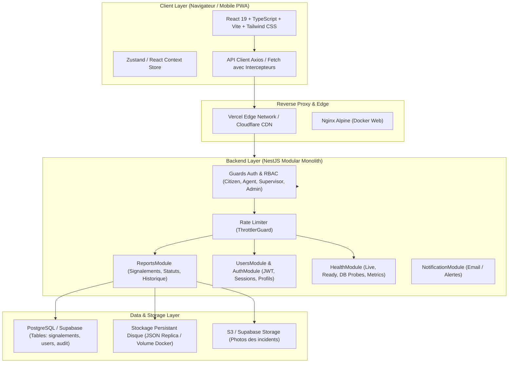

# Architecture Système — Kalaa Connect

**Projet** : Kalaa Connect — Plateforme Municipale Intelligente  
**Auteure** : Nada SLAMA (Élève-Ingénieure ESPRIT)  
**Encadrante Professionnelle** : Mme Dalila KHLIFA (Municipalité de Kalâa Seghira)  
**Année Universitaire** : 2025–2026  

---

## 1. Vue d’Ensemble et Philosophie de Conception

Kalaa Connect est conçu selon les principes d’une **architecture modulaire en couches (Modular Monolith)** pour le backend, couplée à une **Single Page Application (SPA) réactive** pour le frontend. Ce choix architectural garantit une haute cohésion fonctionnelle, un découplage maîtrisé, des performances optimales et une maintenabilité adaptée aux contraintes des collectivités territoriales.



---

## 2. Découpage Modulaire du Backend (NestJS)

Le backend NestJS applique strictement l'injection de dépendances et le patron de conception DTO (Data Transfer Object) avec validation déclarative (`class-validator`) :

1. **`AuthModule` & `UsersModule`** :
   - Gestion du cycle de vie des utilisateurs (citoyens, agents municipaux, superviseurs, administrateurs).
   - Hachage cryptographique sécurisé des mots de passe.
   - Émission et vérification des jetons JWT avec gestion d'expiration et rotation.
   - Contrôle d'accès basé sur les rôles (`RolesGuard`, `@Roles(...)`).

2. **`ReportsModule`** :
   - Cœur métier de la gestion des incidents municipaux (voirie, éclairage, propreté, espaces verts).
   - Machine à états finis régissant le cycle de vie d'un signalement : `NOUVEAU` $\rightarrow$ `PRIS_EN_CHARGE` $\rightarrow$ `EN_COURS` $\rightarrow$ `RESOLU` $\rightarrow$ `REJETE`.
   - Traçabilité et journalisation d'audit des modifications de statut et des interventions techniques.
   - Synchronisation bidirectionnelle entre la base managée Supabase et la persistance locale de secours.

3. **`HealthModule` & `MetricsModule`** :
   - Exposition de sondes normalisées Kubernetes (`/api/health/live`, `/api/health/ready`, `/api/health/db`).
   - Métriques applicatives au format Prometheus (`/api/metrics`) mesurant le trafic HTTP, la consommation mémoire et la répartition des signalements par statut.

4. **`DatabaseModule`** :
   - Abstraction de la couche d'accès aux données.
   - Gestion robuste de la connectivité réseau, reprise sur incident en cas d'indisponibilité du service cloud distant et sérialisation atomique.

---

## 3. Architecture Frontend (React & Tailwind CSS)

L'interface utilisateur adopte les standards **UI/UX Pro Max** pour offrir une expérience ergonomique et inclusive :
- **Composants atomiques réutilisables** : Boutons d'action, modales de confirmation, badges de priorité et de statut conformes aux directives d'accessibilité WCAG AA.
- **Cartographie interactive (Leaflet / OpenStreetMap)** : Géolocalisation précise des incidents sur le périmètre de Kalâa Seghira (latitude : 35.83, longitude : 10.58).
- **Internationalisation bilingue** : Bascule instantanée entre le Français et l'Arabe (RTL supporté) pour assurer l'accessibilité à l'ensemble des administrés.
- **Gestion des états et du cache** : Invalidation granulaire des données après mise à jour, suppression ou changement de statut pour éviter tout affichage désynchronisé.

---

## 4. Flux de Données et Sécurité de bout en bout

```
[Citoyen / Agent] 
       │ (HTTPS / TLS 1.3)
       ▼
[Nginx / CDN Edge] 
       │ (Headers de sécurité : HSTS, CSP, X-Frame-Options)
       ▼
[NestJS API Gateway]
  ├── Intercepteur de métriques (Prometheus)
  ├── Rate Limiter (Protection Brute-Force & DoS)
  ├── ValidationPipe (Nettoyage & typage strict des payloads)
  ├── AuthGuard / RolesGuard (Vérification des privilèges)
  └── Service Métier (Transaction ACID & Journal d'Audit)
       │
       ├── Écriture Supabase PostgreSQL
       └── Réplication atomique disque (Volume persistant)
```
