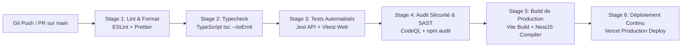

# Pipeline CI/CD & Automatisation DevSecOps — Kalaa Connect

**Projet** : Kalaa Connect  
**Auteure** : Nada SLAMA (Élève-Ingénieure ESPRIT)  
**Encadrante Professionnelle** : Mme Dalila KHLIFA (Municipalité de Kalâa Seghira)  
**Année Universitaire** : 2025–2026  

---

## 1. Philosophie DevSecOps et Intégration Continue

Pour garantir une qualité industrielle du code et éliminer les régressions avant toute mise en production, Kalaa Connect intègre un pipeline DevSecOps complet orchestré par **GitHub Actions**.

---

## 2. Définition des Workflows GitHub Actions

### Workflow Principal (`.github/workflows/ci.yml`)
Ce workflow s'exécute automatiquement sur chaque `push` et `pull_request` ciblant la branche `main` :

1. **Vérification de l'intégrité des dépendances** : Validation du fichier `package-lock.json` via `npm ci` pour des builds déterministes.
2. **Contrôle Qualité Statique** :
   - Exécution de ESLint sur les workspaces `apps/api` et `apps/web`.
   - Contrôle strict du typage TypeScript via `npx tsc --noEmit`.
3. **Tests Unitaires et d'Intégration** :
   - Exécution de la suite de 29 tests Jest côté backend NestJS.
   - Exécution des tests Vitest pour les composants UI React.
4. **Build de Production** :
   - Compilation du bundle frontend optimisé (minification, tree-shaking, hashage des assets).
   - Compilation du binaire JavaScript NestJS dans `dist/`.

### Workflow de Sécurité Applicative (`.github/workflows/security.yml`)
- Analyse statique automatisée de sécurité (SAST) via **GitHub CodeQL** pour détecter les failles d'injection SQL, XSS, et fuites d'informations sensibles.
- Audit des vulnérabilités des dépendances tierces via `npm audit --audit-level=high`.

---

## 3. Matrice de Qualité et SonarQube Quality Gate

Le fichier `sonar-project.properties` configure l'intégration avec SonarQube / SonarCloud :
- **Coverage minimum requis** : 80% sur les modules métier critiques (`ReportsService`, `AuthService`, `DatabaseService`).
- **Zéro vulnérabilité critique ou bloquante** (Vulnerabilities = 0, Security Hotspots = 0).
- **Duplication de code** tolérée < 3%.

---

## 4. Déploiement Continu (CD) vers Vercel

Dès validation complète de tous les jalons de la chaîne CI :
1. Un webhook de déploiement déclenche le build Vercel.
2. Les variables d'environnement (`VITE_API_URL`, `SUPABASE_URL`) sont injectées de manière sécurisée via le coffre-fort de secrets.
3. Le site est déployé avec un identifiant de commit unique et bascule en production sans interruption de service (Zero-Downtime Deployment).
