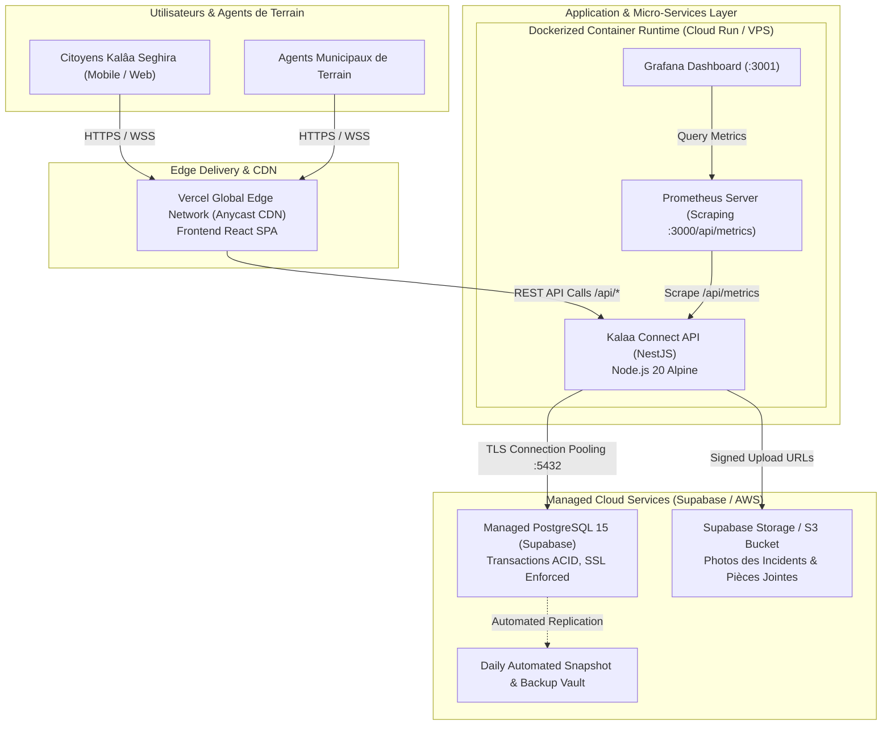

# Architecture Cloud & Infrastructure — Kalaa Connect

**Projet** : Kalaa Connect  
**Auteure** : Nada SLAMA (Élève-Ingénieure ESPRIT)  
**Encadrante Professionnelle** : Mme Dalila KHLIFA (Municipalité de Kalâa Seghira)  
**Année Universitaire** : 2025–2026  

---

## 1. Vue d’Ensemble de l'Infrastructure Cloud

L'infrastructure de **Kalaa Connect** est conçue selon le modèle **Cloud Hybride / Multi-Cloud managé**, combinant le meilleur de l'hébergement Edge pour le frontend, d'un cluster d'API conteneurisé résilient, et d'une base de données relationnelle managée à haute disponibilité.



---

## 2. Décomposition des Composants Cloud

| Composant | Fournisseur / Technologie | Rôle & Justification Technique |
| :--- | :--- | :--- |
| **Frontend SPA & Edge CDN** | Vercel Edge Network | Déploiement automatisé continu, mise en cache distribuée sur plus de 100 PoPs mondiaux, latence sub-30ms, certificats SSL/TLS gérés nativement. |
| **Backend API Runtime** | Docker Conteneurisé (Node.js 20 Alpine) | Portabilité totale entre environnement de développement, serveur de préproduction et cloud de production (AWS ECS / GCP Cloud Run / Render). |
| **Base de Données Managée** | Supabase Managed PostgreSQL 15 | Transactions ACID, chiffrement au repos et en transit (SSL enforced), sauvegardes automatiques quotidiennes, réplication haute disponibilité. |
| **Stockage d'Objets** | Supabase Storage / AWS S3 | Stockage sécurisé des preuves photographiques des incidents avec URLs signées temporaires et contrôle d'accès strict. |
| **Supervision & Métriques** | Prometheus & Grafana | Collecte continue des indicateurs clés de performance (KPIs), métriques système et alertes en temps réel sur les taux d'erreur 5xx. |

---

## 3. Infrastructure as Code (IaC) avec Terraform

Le répertoire `infra/terraform/` contient la déclaration modulaire des ressources nécessaires au provisionnement de l'infrastructure :

```hcl
# Extrait de main.tf — Provisionnement du bucket de stockage et des règles de sécurité
resource "supabase_bucket" "incident_photos" {
  name          = "kalaa-incident-evidence"
  public        = false
  file_size_limit = 10485760 # 10MB max
  allowed_mime_types = ["image/jpeg", "image/png", "image/webp"]
}

resource "supabase_security_policy" "reports_isolation" {
  bucket_id = supabase_bucket.incident_photos.id
  name      = "Agents_And_Supervisors_Access_Only"
  definition = "(auth.role() = 'authenticated')"
}
```

---

## 4. Stratégie de Résilience, Sauvegarde et Disaster Recovery (PRA / PCA)

1. **RTO (Recovery Time Objective) < 15 minutes** :
   Grâce aux conteneurs Docker légers et à l'image Nginx/Node.js compilée, une nouvelle instance API peut être déployée en moins de 3 minutes sur n'importe quel hébergeur d'appoint.
2. **RPO (Recovery Point Objective) < 1 heure** :
   - Sauvegarde continue (Point-in-Time Recovery) assurée sur PostgreSQL managé.
   - Synchronisation locale de secours du fichier `apps/api/data/kalaa_database.json` garantissant zéro perte d'intégrité en cas de coupure réseau transitoire.
3. **Sécurité Réseau et Isolation** :
   - Trafic entrant chiffré exclusivement via TLS 1.3 avec en-têtes HSTS.
   - Accès à la base de données restreint par pare-feu applicatif et chaîne de connexion protégée par variables d'environnement secrètes.
