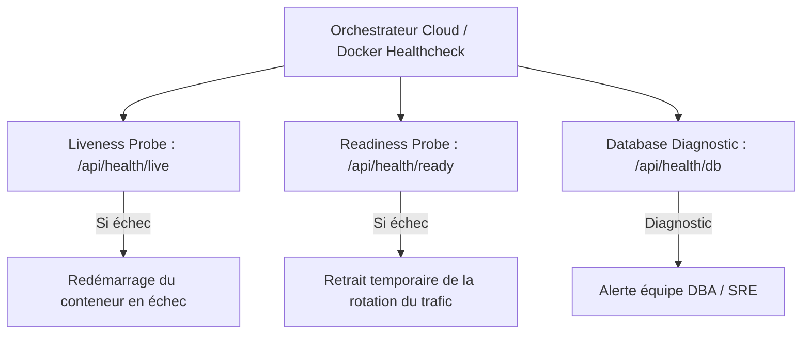

# Sondes de Santé (Health Checks) & Probes — Kalaa Connect

**Projet** : Kalaa Connect  
**Auteure** : Nada SLAMA (Élève-Ingénieure ESPRIT)  
**Encadrante Professionnelle** : Mme Dalila KHLIFA (Municipalité de Kalâa Seghira)  
**Année Universitaire** : 2025–2026  

---

## 1. Principes des Sondes de Santé en Environnement Cloud

Pour permettre aux orchestrateurs (Kubernetes, Docker Swarm, AWS ECS, Google Cloud Run) de gérer automatiquement le cycle de vie, les redémarrages et le routage du trafic, Kalaa Connect expose trois sondes spécialisées :



---

## 2. Spécification Détaillée des Endpoints

### 2.1 Sonde de Vivacité (Liveness Probe) — `GET /api/health/live`
Vérifie que le processus Node.js s'exécute normalement et ne subit pas d'interblocage (deadlock) de sa boucle d'événements (Event Loop).

**Réponse attendue (`200 OK`)** :
```json
{
  "status": "ok",
  "probe": "liveness",
  "uptime": 1420.52,
  "timestamp": "2026-10-11T14:48:00.000Z"
}
```

### 2.2 Sonde d'Aptitude au Service (Readiness Probe) — `GET /api/health/ready`
Valide que le backend est en mesure d'honorer les requêtes des utilisateurs : connectivité établie avec Supabase PostgreSQL et disponibilité du fichier de réplication disque persistant.

**Réponse en cas de succès (`200 OK`)** :
```json
{
  "status": "ready",
  "database": "connected",
  "storage": "persisted",
  "reportsLoaded": 12,
  "usersLoaded": 4
}
```

**Réponse en cas d'incident critique (`503 Service Unavailable`)** :
```json
{
  "status": "unhealthy",
  "database": "disconnected",
  "error": "Connection to PostgreSQL host timed out"
}
```

### 2.3 Diagnostic Base de Données — `GET /api/health/db`
Exécute une requête `SELECT 1;` active ou un contrôle d'intégrité de la table `signalements` pour valider les temps de latence de lecture/écriture.

---

## 3. Configuration dans Docker Compose

```yaml
api:
  build:
    context: .
    dockerfile: apps/api/Dockerfile
  healthcheck:
    test: ["CMD", "curl", "-f", "http://localhost:3000/api/health/ready"]
    interval: 15s
    timeout: 5s
    retries: 3
    start_period: 10s
```
