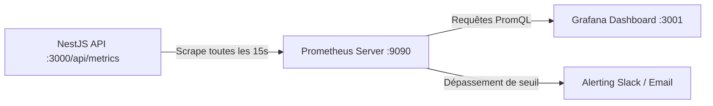

# Monitoring, Métriques & Observabilité — Kalaa Connect

**Projet** : Kalaa Connect  
**Auteure** : Nada SLAMA (Élève-Ingénieure ESPRIT)  
**Encadrante Professionnelle** : Mme Dalila KHLIFA (Municipalité de Kalâa Seghira)  
**Année Universitaire** : 2025–2026  

---

## 1. Philosophie d'Observabilité & Métriques Applicatives

Kalaa Connect intègre une observabilité native basée sur le standard industriel **Prometheus & Grafana**. Le backend NestJS expose dynamiquement des métriques au format texte Prometheus sur l'endpoint `/api/metrics`.



---

## 2. Spécification des Métriques Exposées

### Métriques Métier (Business KPIs)
- `kalaa_reports_total{status="NOUVEAU"}` : Nombre de nouveaux signalements en attente de tri.
- `kalaa_reports_total{status="PRIS_EN_CHARGE"}` : Signalements pris en charge par les services techniques.
- `kalaa_reports_total{status="EN_COURS"}` : Interventions actuellement en cours de traitement sur le terrain.
- `kalaa_reports_total{status="RESOLU"}` : Incidents clôturés avec succès.
- `kalaa_reports_total{status="REJETE"}` : Signalements non recevables ou doublons.

### Métriques Techniques & Performance (SRE Metrics)
- `kalaa_http_requests_total{method="GET|POST|PATCH", status="200|400|500"}` : Volume total et taux d'erreurs HTTP.
- `kalaa_http_request_duration_seconds` : Histogramme des latences de traitement par endpoint.
- `kalaa_memory_heap_used_bytes` / `kalaa_memory_rss_bytes` : Empreinte mémoire du runtime Node.js.
- `kalaa_uptime_seconds` : Temps de fonctionnement continu sans crash.

---

## 3. Configuration de Prometheus (`supervision/prometheus.yml`)

```yaml
global:
  scrape_interval: 15s
  evaluation_interval: 15s

scrape_configs:
  - job_name: 'kalaa-connect-api'
    metrics_path: '/api/metrics'
    static_configs:
      - targets: ['api:3000']
        labels:
          environment: 'production'
          service: 'backend-core'
```

---

## 4. Seuils d'Alerte et SLI / SLO (Service Level Objectives)

| Indicateur (SLI) | Objectif de Service (SLO) | Règle d'Alerte Prometheus |
| :--- | :--- | :--- |
| **Disponibilité globale** | 99.9% de requêtes sans erreur 5xx | `rate(kalaa_http_requests_total{status=~"5.."}[5m]) / rate(kalaa_http_requests_total[5m]) > 0.01` |
| **Latence p95** | < 250 ms pour toutes les requêtes API | `histogram_quantile(0.95, sum(rate(kalaa_http_request_duration_seconds_bucket[5m])) by (le)) > 0.25` |
| **Surcharge Mémoire** | < 85% de la limite du conteneur (512MB) | `kalaa_memory_rss_bytes > 429496729` pendant 5 minutes |
