# RÉPUBLIQUE TUNISIENNE
## MINISTÈRE DE L’ENSEIGNEMENT SUPÉRIEUR ET DE LA RECHERCHE SCIENTIFIQUE
### DIRECTION GÉNÉRALE DES ÉTUDES TECHNOLOGIQUES & ÉCOLES D'INGÉNIEURS
### ÉCOLE SUPÉRIEURE PRIVÉE D'INGÉNIERIE ET DE TECHNOLOGIES (ESPRIT)
#### DÉPARTEMENT GÉNIE INFORMATIQUE

---

# RAPPORT DE STAGE DE PERFECTIONNEMENT
### 2ème Année Cycle Ingénieur en Informatique

<br/>

## **Sujet :**
# KALAA CONNECT : Conception et Développement d'une Plateforme Web & Mobile Citoyenne pour la Gestion et le Suivi des Interventions et Signalements Municipaux

<br/>

**Organisme d'accueil :** Municipalité de Kalâa Seghira (بلدية القلعة الصغرى - Gouvernorat de Sousse)  
**Réalisé par :** Nada SLAMA  
**Encadrante Professionnelle :** Mme Dalila KHLIFA (Responsable des Services Techniques & SI)  
**Année Universitaire :** 2025 - 2026  

---

<div style="page-break-after: always;"></div>

# Remerciements

En premier lieu, je tiens tout d’abord à remercier **Dieu le Tout-Puissant et Miséricordieux**, qui m’a accordé la santé, la volonté et la persévérance nécessaires pour mener à bien ce modeste travail et surmonter tous les défis techniques et méthodologiques rencontrés.

J'exprime mes remerciements les plus sincères et ma profonde gratitude à mon encadrante professionnelle, **Madame Dalila KHLIFA**, Responsable au sein de la Direction des Services Techniques de la Municipalité de Kalâa Seghira. Je la remercie chaleureusement pour son accueil bienveillant, la confiance qu'elle m'a accordée, son encadrement rigoureux, sa disponibilité constante et ses précieux conseils qui ont guidé la conception fonctionnelle et opérationnelle de cette solution.

Mes vifs remerciements s’adressent également à l’ensemble des cadres, agents et collaborateurs de la **Municipalité de Kalâa Seghira**, en particulier les équipes des services de la voirie, de l'éclairage public, de la propreté urbaine et du Bureau des Relations avec le Citoyen (BRC), pour leur collaboration active, leur patience lors du recueil du besoin et le partage généreux de leur savoir-faire métier.

Je tiens aussi à exprimer ma reconnaissance envers le corps professoral et l'administration de l'**École Supérieure Privée d'Ingénierie et de Technologies (ESPRIT)** pour la qualité de l'enseignement académique, des principes d'ingénierie logicielle et des compétences professionnelles qui m'ont été inculqués durant mon cursus.

Mes sincères remerciements vont également aux membres du jury pour l'honneur qu'ils me font en acceptant d’évaluer ce travail et de l’enrichir par leurs avis constructifs et leurs recommandations scientifiques.

Enfin, je ne saurais clore cette page sans exprimer mon amour et mon infinie gratitude à **mes chers parents**, ma famille et mes proches pour leurs sacrifices inconditionnels, leur soutien moral indéfectible et leurs encouragements quotidiens tout au long de mes études.

---

<div style="page-break-after: always;"></div>

# Sommaire

- **Introduction Générale** ........................................................................................................ 1
- **Chapitre 1 : Cadre Général du Projet** ............................................................................... 3
  - 1. Présentation de l’organisme d’accueil ............................................................................ 3
    - 1.1. Fiche signalétique et contexte historique .............................................................. 3
    - 1.2. Découpage territorial et compétences municipales ............................................. 4
    - 1.3. Organigramme administratif et technique ............................................................. 5
  - 2. Étude de l’existant .......................................................................................................... 6
    - 2.1. Description du processus actuel des signalements ............................................... 6
    - 2.2. Critique de l’existant et limites relevées ................................................................. 7
    - 2.3. Solution proposée : Plateforme Kalaa Connect ..................................................... 8
  - 3. Méthodologie de travail ................................................................................................. 9
    - 3.1. Méthodologie Classique (Cascade/V) vs Méthodologies Agiles ........................... 9
    - 3.2. Justification et adoption du Framework Scrum ..................................................... 10
    - 3.3. Découpage temporel et organisation des Sprints ................................................. 11
  - Conclusion du Chapitre 1 ................................................................................................. 12
- **Chapitre 2 : Analyse et Spécification des Besoins** ........................................................... 13
  - 1. Identification et typologie des acteurs .......................................................................... 13
  - 2. Spécification des besoins fonctionnels ......................................................................... 14
    - 2.1. Espace Citoyen ....................................................................................................... 14
    - 2.2. Espace Agent Municipal de Terrain ....................................................................... 15
    - 2.3. Espace Administration & Supervision ................................................................... 15
  - 3. Spécification des besoins non fonctionnels ................................................................... 16
  - 4. Product Backlog global du projet .................................................................................... 17
  - 5. Modélisation par les diagrammes de cas d’utilisation .................................................... 20
    - 5.1. Diagramme de cas d’utilisation global ................................................................... 20
    - 5.2. Diagramme de cas d’utilisation détaillé : Espace Citoyen ...................................... 21
    - 5.3. Diagramme de cas d’utilisation détaillé : Espace Municipal & Admin .................... 22
  - Conclusion du Chapitre 2 ................................................................................................. 23
- **Chapitre 3 : Conception du Système** ................................................................................ 24
  - 1. Choix du langage de modélisation UML ........................................................................ 24
  - 2. Conception de l’architecture technique globale ............................................................ 24
    - 2.1. Modèle Architectural 3-Tiers découplé ................................................................. 24
    - 2.2. Sécurité et flux de données ................................................................................... 25
  - 3. Conception statique : Diagramme de classes ................................................................. 26
  - 4. Conception dynamique : Diagrammes de séquence ...................................................... 28
    - 4.1. Diagramme de séquence : Authentification sécurisée JWT .................................... 28
    - 4.2. Diagramme de séquence : Déclaration d'un signalement géolocalisé .................... 29
    - 4.3. Diagramme de séquence : Affectation et prise en charge d'un ticket .................... 30
    - 4.4. Diagramme de séquence : Résolution et clôture avec photo-preuve ..................... 31
  - 5. Diagramme d'activités : Cycle de vie d'un incident ....................................................... 32
  - Conclusion du Chapitre 3 ................................................................................................. 33
- **Chapitre 4 : Réalisation et Environnement de Développement** ...................................... 34
  - 1. Environnement matériel ................................................................................................ 34
  - 2. Langages et syntaxes adoptés ....................................................................................... 34
  - 3. Environnements logiciels et outils d'ingénierie .............................................................. 35
  - 4. Frameworks et socle technologique .............................................................................. 37
  - 5. Réalisation des Sprints et interfaces graphiques ........................................................... 39
    - 5.1. Sprint 1 : Socle, Authentification et Back-Office d'administration ........................ 39
    - 5.2. Sprint 2 : Module Citoyen (Signalement, GPS et Photos) ...................................... 42
    - 5.3. Sprint 3 : Module Agent & Tableaux de Bord de Supervision ................................ 45
  - 6. Stratégie de tests et assurance qualité logicielle .......................................................... 48
  - Conclusion du Chapitre 4 ................................................................................................. 50
- **Chapitre 5 : Cloud Engineering, DevSecOps, Observabilité et Fiabilité** .................... 51
  - 1. Démarche Cloud Engineering et Architecture Hybride .......................................... 51
  - 2. Résolution Critique : Investigation et Correction de la Défaillance d'Écriture BD ..... 53
  - 3. Conteneurisation et Orchestration Docker Multi-Services ..................................... 56
  - 4. Pipeline DevSecOps & Automatisation CI/CD (GitHub Actions, CodeQL) ......... 58
  - 5. Sécurité Applicative, Modèle de Menaces STRIDE et RBAC .................................... 60
  - 6. Sondes de Santé Kubernetes et Monitoring en Temps Réel (Prometheus/Grafana) .. 62
  - 7. Validation E2E sur Navigateur Réel (Edge Chromium) et Preuves Visuelles .......... 65
  - 8. Analyse des Coûts Cloud (FinOps) et Compromis d'Ingénierie ................................ 67
  - Conclusion du Chapitre 5 ................................................................................................. 69
- **Conclusion Générale et Perspectives** .............................................................................. 70
- **Bibliographie** .................................................................................................................... 72
- **Webographie** .................................................................................................................... 73

---

<div style="page-break-after: always;"></div>

# Liste des Figures

- **Figure 1 :** Organigramme administratif et technique de la Municipalité de Kalâa Seghira
- **Figure 2 :** Comparaison entre la Méthodologie Classique (Cycle en V) et la Méthodologie Agile (Scrum)
- **Figure 3 :** Diagramme de cas d’utilisation global du système Kalaa Connect
- **Figure 4 :** Diagramme de cas d’utilisation détaillé : Espace Citoyen
- **Figure 5 :** Diagramme de cas d’utilisation détaillé : Espace Agent et Administrateur
- **Figure 6 :** Architecture technique N-Tiers découplée de la plateforme
- **Figure 7 :** Diagramme de classes métier du domaine Kalaa Connect
- **Figure 8 :** Diagramme de séquence : Inscription et Authentification JWT
- **Figure 9 :** Diagramme de séquence : Création d'un signalement citoyen géolocalisé avec photo
- **Figure 10 :** Diagramme de séquence : Prise en charge et affectation d'une intervention
- **Figure 11 :** Diagramme de séquence : Résolution d'incident avec preuve et notification citoyenne
- **Figure 12 :** Diagramme d'activités UML du cycle de vie complet d'un signalement
- **Figure 13 :** Environnement matériel de développement
- **Figure 14 :** Modèle relationnel de la base de données (Prisma Schema Entity-Relationship)
- **Figure 15 :** Page d'accueil publique et présentation de l'application PWA Kalaa Connect
- **Figure 16 :** Interface d'authentification (Connexion avec jeton JWT sécurisé)
- **Figure 17 :** Interface de création de compte citoyen avec validation des données
- **Figure 18 :** Formulaire de déclaration d'incident avec sélection de catégorie et champ interactif
- **Figure 19 :** Module de capture d'image et compression locale avant téléversement
- **Figure 20 :** Module de géolocalisation GPS automatique par API HTML5 Geolocation
- **Figure 21 :** Carte interactive des signalements municipaux de Kalâa Seghira
- **Figure 22 :** Espace personnel Citoyen : Suivi des signalements et statuts en temps réel
- **Figure 23 :** Tableau de bord de l'agent municipal de terrain (Interventions assignées)
- **Figure 24 :** Fiche détaillée d'intervention avec itinéraire et description de l'anomalie
- **Figure 25 :** Interface de clôture d'intervention avec prise de photo post-réparation
- **Figure 26 :** Tableau de bord d'administration générale (Superviseur municipal)
- **Figure 27 :** Module de gestion et d'affectation des agents municipaux par spécialité
- **Figure 28 :** Rapports statistiques d'incidents par arrondissement (Medina, Echragi, Hassed, Ennogra)
- **Figure 29 :** Interface adaptative PWA (Responsive Mobile, Tablette et Desktop)

---

<div style="page-break-after: always;"></div>

# Liste des Tableaux

- **Tableau 1 :** Fiche d'identité signalétique de la Municipalité de Kalâa Seghira
- **Tableau 2 :** Analyse comparative : Gestion traditionnelle papier vs Solution digitale Kalaa Connect
- **Tableau 3 :** Identification et profilage des acteurs du système
- **Tableau 4 :** Product Backlog priorisé (Méthode MoSCoW, Story Points et Critères d'acceptation)
- **Tableau 5 :** Planification des Sprints Scrum du projet (S1, S2, S3)
- **Tableau 6 :** Répertoire des langages informatiques exploités
- **Tableau 7 :** Environnements et outils logiciels utilisés
- **Tableau 8 :** Frameworks, bibliothèques et socles technologiques
- **Tableau 9 :** Synthèse d'exécution des tests automatisés (Backend NestJS & Frontend React)

---

<div style="page-break-after: always;"></div>

# Introduction Générale

À l’ère de la transformation numérique des collectivités territoriales et de l’émergence du concept de « Smart City » (ville intelligente), les municipalités modernes se trouvent confrontées à une attente citoyenne croissante en matière de transparence, de réactivité et de qualité des services publics de proximité. La gestion du cadre de vie communal, englobant la réfection de la voirie, la maintenance de l’éclairage public, la salubrité urbaine, la valorisation des espaces verts et la sécurité des infrastructures, constitue le cœur de la mission des collectivités locales.

Cependant, dans de nombreuses municipalités tunisiennes, les modes de communication et de gestion opérationnelle demeurent encore largement tributaires de circuits traditionnels : réclamations verbales au guichet, dépôts de courriers manuscrits, appels téléphoniques informels ou doléances recueillies de manière disparate sur les réseaux sociaux. Cette organisation manuelle engendre des retards considérables dans le traitement des requêtes, des pertes d'informations critiques (notamment la localisation exacte de l'anomalie et son degré d'urgence), ainsi qu'une incapacité pour les services techniques municipaux d'optimiser l'affectation de leurs équipes sur le terrain.

C’est précisément au cœur de cette problématique que s’inscrit notre stage de perfectionnement effectué au sein de la **Municipalité de Kalâa Seghira** (بلدية القلعة الصغرى), sous la direction de notre encadrante professionnelle, **Madame Dalila KHLIFA**. Située dans le gouvernorat de Sousse, la commune de Kalâa Seghira connaît une expansion urbaine et démographique notable. Pour répondre avec efficacité aux attentes légitimes de ses administrés, la municipalité a exprimé le besoin stratégique de concevoir et déployer une plateforme logicielle intégrée, moderne et collaborative, baptisée **« Kalaa Connect »**.

Le projet a pour ambition majeure de digitaliser de bout en bout la chaîne de traitement des anomalies urbaines :
1. Offrir aux citoyens de Kalâa Seghira une interface web et mobile (PWA) intuitive leur permettant de déclarer en quelques clics une anomalie sur la voie publique, en y associant automatiquement des coordonnées géographiques précises (GPS) et des photographies probantes.
2. Équiper les agents municipaux de terrain et les responsables de service d'un outil de pilotage opérationnel facilitant la réception, l'assignation, le suivi en temps réel et la clôture justifiée des interventions techniques.
3. Fournir aux décideurs municipaux un tableau de bord analytique centralisant les statistiques territoriales par arrondissement (Centre-ville, Echragi, Hassed, Ennogra - Oued Laya), favorisant ainsi une maintenance préventive et une allocation rationnelle des ressources communales.

Pour rendre compte de l’ensemble de ce travail d’ingénierie logicielle, le présent rapport est structuré selon quatre chapitres fondamentaux :

* **Le premier chapitre, intitulé « Cadre Général du Projet »,** est consacré à la présentation approfondie de la Municipalité de Kalâa Seghira, à l'analyse critique de l'existant, à la formulation de la solution cible et à la justification de la méthodologie de conduite de projet Agile Scrum.
* **Le deuxième chapitre, « Analyse et Spécification des Besoins »,** identifie les profils des utilisateurs, formalise l'intégralité des besoins fonctionnels et non fonctionnels, et expose le Product Backlog complet ainsi que les diagrammes de cas d'utilisation UML.
* **Le troisième chapitre, « Conception du Système »,** explicite l'architecture logicielle retenue (3-Tiers découplée), la modélisation statique à travers le diagramme de classes métier, ainsi que la dynamique des interactions via les diagrammes de séquence système et le diagramme d'activités.
* **Le quatrième chapitre, « Réalisation et Environnement de Développement »,** décrit l'environnement matériel et technologique (NestJS, React, TypeScript, Prisma, TailwindCSS), détaille le déroulement des Sprints et présente les captures d'écrans des interfaces développées ainsi que la stratégie de tests automatisés.

Enfin, une **conclusion générale** dresse le bilan des compétences acquises, évalue les résultats obtenus et propose les perspectives d'évolution pour pérenniser et enrichir la solution au service de la collectivité locale.

---

<div style="page-break-after: always;"></div>

# Chapitre 1 : Cadre Général du Projet

## Introduction

Tout projet informatique d'envergure nécessite une compréhension préalable et approfondie de son environnement d'implantation et des dynamiques humaines et organisationnelles qui l'entourent. Ce premier chapitre pose les jalons de notre travail. Nous présentons tout d'abord l'organisme d'accueil, la **Municipalité de Kalâa Seghira**, son patrimoine historique, son rôle administratif, sa structure organisationnelle et ses spécificités techniques. Ensuite, nous procédons à une étude minutieuse des procédures existantes de gestion des doléances communales afin d'en dégager les limites objectives. Enfin, nous introduisons la solution digitale proposée, **Kalaa Connect**, et nous argumentons le choix de la méthodologie de gestion de projet Agile Scrum pour mener à bien nos développements dans un cadre itératif et maîtrisé.

---

## 1. Présentation de l’organisme d’accueil

### 1.1. Fiche signalétique et contexte historique

La ville de **Kalâa Seghira** (القلعة الصغرى) est une cité tunisienne au passé millénaire, située dans la région du Sahel, à environ 6 kilomètres à l'ouest de la ville de Sousse.

Sur le plan archéologique et historique, les origines de Kalâa Seghira remontent à la période punique et phénicienne, où la localité portait le nom de **Gurza** (قيرزا), un relais stratégique établi sur des bases antiques pour surveiller et sécuriser les voies caravanières intérieures vers Hadrumetum (l'actuelle Sousse). Au fil des siècles, et particulièrement à l'époque médiévale aghlabide puis hafside, le site a constitué un point fortifié (« Kalâa », signifiant forteresse ou citadelle) jouant un rôle de protection et de liaison défensive avec les autres places fortes du Sahel tunisien, notamment la ville sœur de Kalâa Kebira.

Sur le plan institutionnel contemporain, la **Municipalité de Kalâa Seghira** a été officiellement érigée en commune par décret le **9 janvier 1957**, au lendemain de l'indépendance de la République Tunisienne. Depuis lors, elle administre les affaires publiques locales, l'aménagement du territoire, l'état civil et le développement économique et social de sa circonscription.

Le tableau ci-dessous récapitule les données administratives et signalétiques de la collectivité :

<br/>

**Tableau 1 : Fiche d'identité signalétique de la Municipalité de Kalâa Seghira**

| Paramètre | Caractéristique / Valeur officielle |
| :--- | :--- |
| **Dénomination officielle** | Municipalité de Kalâa Seghira (بلدية القلعة الصغرى) |
| **Date de création légale** | 9 Janvier 1957 |
| **Région administrative** | Gouvernorat de Sousse - République Tunisienne |
| **Localisation géographique** | Coordonnées : 35°49′35″ Nord, 10°33′30″ Est (à 6 km à l'ouest de Sousse) |
| **Superficie communale** | Environ 3 600 hectares (~36 km²) |
| **Population estimée** | Environ 37 000 habitants (en forte dynamique démographique) |
| **Activités économiques majeures** | Oléiculture (huile d'olive de renommée), silos céréaliers, industrie mécanique et matériaux de construction (briqueteries) |
| **Périmètres administratifs** | El Medina (Centre), Echragi, Hassed, Ennogra - Oued Laya |
| **Portail officiel** | `www.commune-kalaasghira.gov.tn` |
| **Encadrante professionnelle** | Mme Dalila KHLIFA (Direction des Services Techniques) |

<br/>

### 1.2. Découpage territorial et compétences municipales

Le territoire communal de Kalâa Seghira est subdivisé en quatre arrondissements et secteurs majeurs, caractérisés par une grande diversité d'infrastructures et de besoins :
1. **L'arrondissement El Medina (Centre-ville) :** Cœur historique et administratif, concentrant les commerces de proximité, l'hôtel de ville, le marché municipal, les établissements scolaires et une densité de circulation élevée.
2. **L'arrondissement Echragi :** Zone résidentielle en pleine extension périurbaine, nécessitant un suivi soutenu de l'extension des réseaux d'éclairage public et du raccordement de la voirie.
3. **L'arrondissement Hassed :** Quartier combinant habitat pavillonnaire et activités artisanales et industrielles légères, avec des impératifs stricts en matière de gestion des déchets et d'entretien des chaussées.
4. **Le secteur Ennogra - Oued Laya :** Zone périurbaine et agricole renommée pour ses oliveraies et ses silos de stockage de céréales, traversée par des axes routiers reliant Kalâa Seghira aux délégations avoisinantes.

Aux termes du Code des Collectivités Locales, la Municipalité de Kalâa Seghira assume des compétences directes indispensables au quotidien des citoyens :
* **Propreté et hygiène publique :** Collecte quotidienne des ordures ménagères, éradication des décharges sauvages, balayage des voies et contrôle sanitaire.
* **Voirie et circulation :** Entretien de la chaussée, réfection des nids-de-poule, pose et réparation des trottoirs, signalisation routière horizontale et verticale.
* **Éclairage public :** Maintenance préventive et curative du réseau électrique urbain, remplacement des luminaires défectueux, mise en conformité énergétique.
* **Espaces verts et environnement :** Élagage des arbres sur les voies publiques, aménagement des squares communaux et entretien des espaces verts municipaux.

<br/>

### 1.3. Organigramme administratif et technique

Pour accomplir ses missions de service public, la commune de Kalâa Seghira s’appuie sur une structure organisationnelle hiérarchisée, présidée par le Conseil Municipal et le Secrétaire Général de la mairie.

Notre stage a été accueilli au sein de la **Direction des Services Techniques (DST)**, sous la supervision directe de **Mme Dalila KHLIFA**. Cette direction représente le poumon opérationnel de la commune, car elle regroupe les ingénieurs, techniciens supérieurs, chefs de chantiers et ouvriers municipaux responsables des travaux neufs et de la maintenance urbaine.

L'organigramme administratif et technique est modélisé ci-dessous :

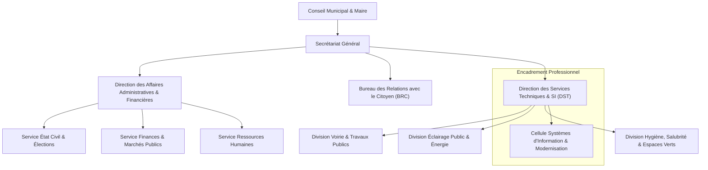
*Figure 1 : Organigramme administratif et technique de la Municipalité de Kalâa Seghira*

---

## 2. Étude de l’existant

### 2.1. Description du processus actuel des signalements

L'immersion au sein des services municipaux de Kalâa Seghira a permis d'étudier en détail la manière dont les dysfonctionnements urbains (lampadaires en panne, chaussée dégradée, canalisations rompues, dépôts anarchiques d'ordures) sont signalés et traités.

Actuellement, le parcours d’un signalement municipal suit un circuit manuel et hétérogène :
1. **Initiation par le citoyen :** Lorsqu'un habitant constate un incident sur la voie publique, il doit soit :
   * Se déplacer physiquement au siège de la municipalité pendant les heures d'ouverture pour consigner sa doléance sur un registre papier au Bureau des Relations avec le Citoyen (BRC).
   * Contacter le standard téléphonique de la municipalité, où un agent retranscrit sommairement l'alerte sur un carnet d'appels.
   * Publier une plainte ou une photo sur les pages informelles des réseaux sociaux, sans garantie de lecture par les agents compétents.
2. **Transmission administrative :** Le responsable du BRC synthétise manuellement les doléances enregistrées dans un rapport périodique ou sur des bordereaux volants qu'il transmet par navette interne à la Direction des Services Techniques.
3. **Planification et intervention :** Le chef des services techniques examine les notes, tente d'identifier les lieux approximatifs décrits par les citoyens, et remet des ordres de mission papier aux équipes d'intervention (électriciens, maçons de voirie, agents de propreté).
4. **Retour d’information et clôture :** Une fois les travaux terminés, les ouvriers en informent oralement leur chef d'équipe lors du retour au dépôt municipal en fin de journée. Le citoyen ayant émis la doléance initiale n'est quasiment jamais informé de la résolution effective de son problème, sauf s'il se déplace à nouveau pour s'en enquérir.

<br/>

### 2.2. Critique de l’existant et limites relevées

L'observation directe du fonctionnement actuel et les entretiens réalisés avec le personnel municipal et les administrés mettent en évidence plusieurs faiblesses critiques :

1. **Imprécision géographique majeure :** Les descriptions textuelles ou orales fournies par les citoyens (« près de l'école dans la cité Echragi », « en face du silo d'Oued Laya ») manquent de repères cartographiques précis. Les agents de terrain perdent un temps précieux à chercher l'emplacement exact de l'anomalie.
2. **Absence d'éléments probants à l'initiation :** Sans photographie immédiate de l'incident, les services techniques ont du mal à apprécier la gravité de l'urgence (simple ampoule grillée vs câble électrique sectionné au sol ; détritus léger vs décharge sauvage nécessitant un camion benne).
3. **Risque élevé de perte et de doublons :** Les registres manuscrits et les fiches volantes sont sujets aux égarements physiques. De plus, lorsqu'un incident majeur survient sur une artère fréquentée, plusieurs citoyens appellent séparément pour le même motif, ce qui génère des redondances et alourdit le travail administratif.
4. **Rupture de communication et opacité :** L'administrateur municipal ne dispose d'aucun indicateur consolidé (SLA, taux de résolution, temps moyen d'intervention). De son côté, le citoyen a le sentiment frustrant que sa réclamation a été ignorée ou classée sans suite.
5. **Inefficience logistique :** Les trajets des équipes de maintenance ne sont pas optimisés selon la proximité géographique des tickets ouverts.

<br/>

**Tableau 2 : Analyse comparative : Gestion traditionnelle papier vs Solution digitale Kalaa Connect**

| Critère d'évaluation | Procédure manuelle existante | Solution digitale cible (Kalaa Connect) |
| :--- | :--- | :--- |
| **Canal d'accès** | Guichet physique ou appel aux horaires administratifs | Application Web & Mobile PWA disponible 24h/24 et 7j/7 |
| **Localisation de l'anomalie** | Description textuelle vague et approximative | Coordonnées GPS précises + Pointage sur carte interactive |
| **Preuve visuelle** | Aucune photo (ou photo éparse sur réseau social) | Téléversement instantané de photos avant et après intervention |
| **Traçabilité du statut** | Opaque (citoyen sans nouvelles du traitement) | Cycle de vie transparent en temps réel (Soumis, Assigné, Résolu) |
| **Pilotage pour la mairie** | Aucun tableau de bord de supervision | Métriques analytiques, cartographie des points chauds et délais moyens |
| **Archivage des données** | Fiches papier volumineuses et périssables | Base de données relationnelle sécurisée et auditable |

<br/>

### 2.3. Solution proposée : Plateforme Kalaa Connect

Pour pallier l'ensemble de ces lacunes, nous proposons la mise en œuvre de **Kalaa Connect**, une plateforme numérique intégrée conçue pour moderniser les interactions entre les habitants et les services municipaux de Kalâa Seghira.

La plateforme repose sur trois volets complémentaires :
* **Un portail citoyen accessible en Progressive Web App (PWA) :** Permettant à tout habitant de Kalâa Seghira de signaler un incident en moins de deux minutes en prenant une photo, en activant sa géolocalisation automatique, en qualifiant la catégorie (Voirie, Éclairage, Propreté, Eau & Assainissement, Espaces Verts) et en suivant l'état d'avancement de son dossier par notification.
* **Une interface mobile dédiée aux agents de terrain :** Offrant aux équipes techniques la consultation de leur planning d'interventions, la visualisation sur plan du lieu exact du sinistre, l'optimisation des déplacements et la clôture de la mission par le téléversement d'une photo-preuve des réparations effectuées.
* **Un tableau de bord d'administration et de supervision (Back-Office) :** Dédié à la Direction des Services Techniques et aux responsables communaux pour superviser le flux des tickets, affecter rationnellement les ordres de mission aux agents compétents, analyser les tendances géographiques des pannes et générer des indicateurs de performance municipale.

---

## 3. Méthodologie de travail

### 3.1. Méthodologie Classique (Cascade/V) vs Méthodologies Agiles

Le choix d'une démarche méthodologique appropriée conditionne la réussite de tout projet d'ingénierie logicielle. Deux grandes approches s'opposent traditionnellement dans le domaine :

* **La méthodologie classique (Cycle en cascade / Cycle en V) :** Elle repose sur une planification séquentielle et prédictive où chaque phase (étude préalable, spécification, conception générale, codage, tests unitaires, recette finale) doit être totalement figée et validée avant d'entamer la phase suivante. Si ce modèle offre un cadre contractuel rigide, il souffre d'un manque criant de flexibilité lorsque les exigences fonctionnelles évoluent au cours du projet et repousse la découverte de l'application utilisable aux phases ultimes du calendrier.
* **Les méthodologies Agiles (notamment Scrum) :** Elles préconisent une approche itérative, collaborative et incrémentale. Le projet est découpé en cycles courts de développement appelés **Sprints** (typiquement de 1 à 3 semaines), produisant à la fin de chaque itération une version fonctionnelle, testée et démontrable du produit. L'implication continue des utilisateurs finaux et des parties prenantes garantit un alignement permanent entre le produit développé et les réalités du terrain.

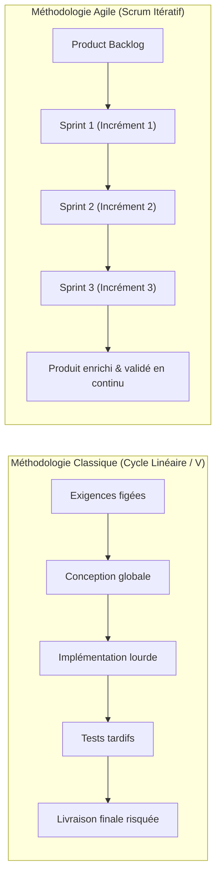
*Figure 2 : Comparaison entre la Méthodologie Classique (Cycle en V) et la Méthodologie Agile (Scrum)*

<br/>

### 3.2. Justification et adoption du Framework Scrum

Pour la réalisation de la plateforme **Kalaa Connect**, notre choix s'est naturellement porté sur le **Framework Scrum**. Plusieurs arguments majeurs justifient cette décision :
1. **Évolution et raffinement des besoins :** La découverte des processus techniques municipaux s'est faite par immersion directe ; une démarche agile a permis d'ajuster les interfaces et les formulaires au fur et à mesure des retours de notre encadrante professionnelle, **Mme Dalila KHLIFA**.
2. **Réduction des risques techniques :** En livrant des incréments logiciels testables dès les premières semaines, les erreurs de conception d'API ou de schéma relationnel ont pu être rectifiées immédiatement.
3. **Visibilité et rigueur :** Scrum impose des cérémonies bien définies (Sprint Planning, Daily Stand-up, Sprint Review et Sprint Retrospective) qui favorisent la rigueur de travail et l'auto-organisation.

Au sein de notre organisation de stage :
* **Product Owner (PO) :** Représenté par **Mme Dalila KHLIFA** (exprimant les besoins fonctionnels de la municipalité et validant les récits utilisateurs).
* **Scrum Master & Équipe de Développement :** Assuré par **Nada SLAMA** (responsable de la formalisation technique, du développement full-stack, des tests et de la livraison continue).

<br/>

### 3.3. Découpage temporel et organisation des Sprints

Le projet s'est articulé autour d'une phase de cadrage initial suivie de **trois Sprints opérationnels** d'une durée moyenne de deux à trois semaines chacun :

* **Sprint 0 (Semaine 1) :** Immersion, analyse de l'existant communal, définition de la charte graphique et configuration de l'architecture logicielle (Monorepo NestJS / React, configuration de Prisma et Docker).
* **Sprint 1 (Semaines 2 et 3) :** Socle technique, gestion de la sécurité, authentification par jetons JWT, gestion des rôles (Citoyen, Agent, Admin) et module d'administration des référentiels communaux.
* **Sprint 2 (Semaines 4 et 5) :** Développement du cœur de l'Espace Citoyen : formulaire de déclaration d'incidents avec capture photo, géolocalisation GPS automatique, carte interactive des incidents et historique personnel.
* **Sprint 3 (Semaines 6 et 7) :** Développement de l'Espace Agent de terrain et Superviseur : tableau de bord des interventions assignées, cycle de changement d'état avec téléversement de la preuve photographique, métriques d'analyse territoriale par arrondissement.
* **Phase de Recette & Finalisation (Semaine 8) :** Tests automatisés (unitaires et intégration), rédaction de la documentation d'exploitation, recette fonctionnelle auprès des équipes municipales et rédaction du rapport final.

---

## Conclusion du Chapitre 1

Dans ce premier chapitre, nous avons situé notre projet dans son contexte institutionnel et territorial au sein de la Municipalité de Kalâa Seghira. L'analyse critique de l'existant a démontré la nécessité urgente de rompre avec les processus manuels et manuscrits pour adopter une solution numérique moderne, accessible et géolocalisée. L'adoption du cadre méthodologique Agile Scrum nous confère l'agilité nécessaire pour concrétiser cette vision. Le chapitre suivant sera consacré à l'analyse formelle et à la spécification exhaustive des besoins de notre futur système.

---

<div style="page-break-after: always;"></div>

# Chapitre 2 : Analyse et Spécification des Besoins

## Introduction

L’analyse et la spécification des besoins constituent le socle de toute ingénierie logicielle réussie. Cette étape a pour but de traduire les attentes et les contraintes exprimées par les différentes parties prenantes municipales en exigences formelles, cohérentes et non ambiguës. Dans ce chapitre, nous identifions d'abord les profils d'acteurs qui interagiront avec la plateforme **Kalaa Connect**. Nous décrivons ensuite de manière exhaustive les besoins fonctionnels et non fonctionnels, avant de présenter le **Product Backlog** complet priorisé selon la méthode MoSCoW. Enfin, nous modélisons les interactions métier à l'aide des diagrammes de cas d'utilisation UML.

---

## 1. Identification et typologie des acteurs

Un acteur, au sens du langage UML, représente une entité extérieure (humaine ou système automatisé) qui interagit directement avec le système logiciel en émettant ou en recevant des données. L'analyse des processus de la commune de Kalâa Seghira nous a permis de distinguer trois acteurs principaux :

<br/>

**Tableau 3 : Identification et profilage des acteurs du système**

| Acteur | Profil / Rôle | Responsabilités majeures dans le système |
| :--- | :--- | :--- |
| **Citoyen** | Tout habitant ou usager de la commune de Kalâa Seghira | - Créer un compte sécurisé et gérer son profil.<br/>- Signaler une anomalie urbaine avec photo, géolocalisation et description.<br/>- Consulter la carte publique des incidents communaux.<br/>- Suivre l'avancement de ses signalements et être notifié de leur résolution. |
| **Agent Municipal** | Ouvrier, technicien ou chef d'équipe de la Direction des Services Techniques | - Consulter la liste des interventions qui lui sont assignées.<br/>- Localiser le lieu exact de l'incident sur plan et planifier l'itinéraire.<br/>- Prendre en charge un ticket (passage au statut « En cours »).<br/>- Clôturer l'intervention en fournissant un compte-rendu et une photo de preuve. |
| **Administrateur / Superviseur** | Responsable technique communal (Mme Dalila Khlifa) ou Secrétaire Général | - Gérer les comptes utilisateurs et attribuer les rôles et habilitations.<br/>- Administrer les référentiels de données (catégories, arrondissements, priorités).<br/>- Affecter manuellement ou automatiquement les signalements aux agents selon leur spécialité.<br/>- Superviser les métriques globales de performance (délais de traitement, cartes de chaleur des pannes). |

---

## 2. Spécification des besoins fonctionnels

Les besoins fonctionnels décrivent les services et les fonctionnalités métier que le système doit impérativement fournir à ses utilisateurs. Ils sont structurés selon les trois espaces applicatifs :

### 2.1. Espace Citoyen

Le module Citoyen doit offrir une expérience fluide, intuitive et accessible depuis un smartphone :
* **Authentification et Profil :** Inscription rapide avec nom, prénom, numéro de téléphone, email et mot de passe chiffré. Possibilité de mettre à jour ses coordonnées personnelles et de réinitialiser son mot de passe.
* **Déclaration d'incident en temps réel :**
  * Saisie d'un titre et d'une description précise de l'anomalie.
  * Sélection de la catégorie correspondante (Voirie / Chaussée dégradée, Éclairage public éteint ou dangereux, Propreté et décharges sauvages, Fuites d'eau et assainissement, Espaces verts et arbres dangereux).
  * Sélection de l'arrondissement communal concerné (Centre El Medina, Echragi, Hassed, Ennogra - Oued Laya).
  * Capture ou sélection directe d'une photographie probante (avec compression côté client pour minimiser la consommation de bande passante).
  * Détection automatique des coordonnées GPS via le capteur du terminal mobile avec possibilité d'ajustement manuel sur un fond de carte interactif.
* **Suivi et Historique des signalements :**
  * Consultation en temps réel du statut de chaque signalement émis (Reçu / Validé, Assigné, En cours d'intervention, Résolu avec succès, Rejeté avec motif motivé).
  * Consultation de la photo post-intervention attestant de la réparation effective par les services municipaux.
* **Consultation de la Carte Publique Communale :** Visualisation des incidents signalés dans la municipalité sous forme de repères géolocalisés pour éviter les signalements redondants par d'autres résidents.

<br/>

### 2.2. Espace Agent Municipal de Terrain

Le module Agent de terrain est optimisé pour une utilisation mobile ou tablette lors des tournées de maintenance :
* **Authentification sécurisée :** Connexion restreinte aux identifiants professionnels attribués par la municipalité.
* **Gestion des ordres de mission (Interventions) :**
  * Visualisation immédiate des tickets assignés avec tri par priorité (Haute / Urgente, Normale, Faible) et par proximité géographique.
  * Accès aux détails complets du problème : photo initiale du citoyen, date, catégorie, coordonnées GPS et observations éventuelles du superviseur.
* **Cycle d'intervention :**
  * Transition d'état : passage du ticket à l'état « En cours » lors du départ sur les lieux ou du début des travaux.
  * Clôture opérationnelle : téléversement obligatoire d'une photographie de preuve montrant le résultat des travaux (ex. lampadaire réparé, nid-de-poule colmaté, détritus enlevés) et saisie d'un commentaire technique de clôture.

<br/>

### 2.3. Espace Administration & Supervision

L'espace Administration est destiné aux cadres et superviseurs de la Direction des Services Techniques (sous la supervision de **Mme Dalila Khlifa**) :
* **Gestion centralisée des incidents :**
  * Vue synthétique tabulaire et cartographique de l'ensemble des tickets de la commune.
  * Outils de filtrage multicritères : par statut, par arrondissement, par catégorie, par priorité et par intervalle de dates.
  * Affectation ou réaffectation d'un ticket à un agent municipal spécifique ou à une équipe selon le métier technique requis.
  * Rejet motivé d'un signalement non recevable (ex. domaine privé, réclamation hors périmètre communal).
* **Administration des utilisateurs et des équipes :** Création, modification, activation et désactivation des comptes d'agents municipaux avec rattachement à une spécialité technique.
* **Tableaux de bord statistiques et reporting :**
  * Visualisation en temps réel du volume de tickets traités, en cours et en attente.
  * Calcul automatique du temps moyen de prise en charge et du temps moyen de résolution (MTTR - Mean Time To Resolution).
  * Répartition des incidents par zone géographique (cartographie des points chauds communaux).

---

## 3. Spécification des besoins non fonctionnels

Les besoins non fonctionnels définissent les critères de qualité technique, d'ergonomie, de performance et de sécurité qui conditionnent l'acceptabilité et la robustesse de la plateforme logicielle :

* **Sécurité et intégrité des données :**
  * Authentification robuste reposant sur des jetons **JWT (JSON Web Tokens)** signés cryptographiquement.
  * Contrôle d'accès basé sur les rôles (**RBAC - Role-Based Access Control**) vérifiant les permissions de chaque utilisateur sur chaque point d'accès de l'API REST.
  * Hachage irréversible des mots de passe à l'aide de l'algorithme `bcrypt` avec un coût de salage suffisant.
  * Protection contre les failles courantes du Web : injections SQL (prévenues par l'ORM Prisma), attaques Cross-Site Scripting (XSS) et Cross-Site Request Forgery (CSRF).
* **Convivialité et Ergonomie (UX/UI) :** L'interface doit être épurée, moderne et intuitive, guidant l'utilisateur de manière fluide sans nécessiter de formation préalable. L'utilisation d'icônes explicites et de retours visuels immédiats (indicateurs de chargement, notifications toast) est impérative.
* **Responsive Design et format PWA (Progressive Web App) :** L'application doit s'adapter parfaitement à toutes les tailles d'écrans (smartphones, tablettes, ordinateurs de bureau). En tant que PWA, elle doit être installable sur l'écran d'accueil d'un smartphone Android ou iOS sans passer obligatoirement par les stores d'applications.
* **Performance et optimisation :** Le temps de chargement initial des pages doit être inférieur à 2 secondes sur une connexion 4G standard. Les photographies téléversées doivent subir une compression automatique côté client afin de réduire la consommation de données mobiles et d'économiser l'espace disque du serveur municipal.
* **Disponibilité et tolérance aux pannes :** L'architecture doit garantir une haute disponibilité du service 24h/24. En cas de coupure temporaire de connectivité Internet sur le terrain, l'application PWA doit conserver les données du formulaire localement (cache / LocalStorage) avant synchronisation automatique dès le rétablissement du réseau.
* **Maintenabilité et évolutivité :** Le code source doit être modulaire, fortement typé avec TypeScript, documenté et couvert par des suites de tests automatisés (Jest et Vitest).

---

## 4. Product Backlog global du projet

Conformément à la méthodologie Scrum, l'ensemble des fonctionnalités requises a été consigné sous forme de récits utilisateurs (**User Stories - US**) dans le **Product Backlog**. Chaque récit utilisateur précise le bénéfice attendu selon la syntaxe standard : *« En tant que [Acteur], je veux [Action] afin de [Bénéfice] »*.

La priorisation a été établie selon la méthode **MoSCoW** :
* **Must have (M) :** Fonctionnalité vitale et incontournable pour le fonctionnement du système.
* **Should have (S) :** Fonctionnalité à haute valeur ajoutée, indispensable au confort d'exploitation.
* **Could have (C) :** Fonctionnalité souhaitable si le temps et les ressources le permettent.
* **Won't have (W) :** Fonctionnalité différée pour une version ultérieure.

L'effort d'implémentation est estimé en **Story Points (SP)** selon la suite de Fibonacci (1, 2, 3, 5, 8, 13) :

<br/>

**Tableau 4 : Product Backlog priorisé du projet Kalaa Connect**

| Réf. US | Récit Utilisateur (User Story) | Priorité MoSCoW | Effort (SP) | Critères d'acceptation | Sprint |
| :---: | :--- | :---: | :---: | :--- | :---: |
| **US-01** | En tant qu'utilisateur, je veux créer un compte avec mon email et un mot de passe sécurisé afin d'accéder aux services de la plateforme. | **Must** | 3 | Formulaire avec validation des formats d'email et robustesse mot de passe. Compte persisté en BDD. | S1 |
| **US-02** | En tant qu'utilisateur enregistré, je veux m'authentifier pour obtenir une session sécurisée et accéder à mon espace dédié. | **Must** | 3 | Émission d'un token JWT valide, persistance sécurisée en stockage local, redirection selon rôle. | S1 |
| **US-03** | En tant qu'administrateur municipal, je veux gérer les référentiels de données (catégories d'incidents, arrondissements) pour structurer les déclarations. | **Must** | 5 | CRUD complet des catégories (Voirie, Éclairage, etc.) et des 4 arrondissements de Kalâa Seghira. | S1 |
| **US-04** | En tant qu'administrateur, je veux créer et gérer les comptes des agents techniques afin de leur assigner des tâches. | **Must** | 5 | Attribution du rôle AGENT, renseignement de la spécialité technique, activation/désactivation. | S1 |
| **US-05** | En tant que citoyen, je veux déclarer un incident en renseignant un titre, une catégorie, une description et un arrondissement afin de prévenir la mairie. | **Must** | 5 | Formulaire dynamique avec contrôles de validation, enregistrement en base au statut « REÇU ». | S2 |
| **US-06** | En tant que citoyen, je veux joindre une photographie de l'anomalie constatée afin d'apporter une preuve visuelle immédiate. | **Must** | 5 | Prise de photo directe via caméra ou sélection galerie, compression côté client, upload multipart. | S2 |
| **US-07** | En tant que citoyen, je veux que mes coordonnées GPS soient détectées automatiquement afin de localiser précisément l'incident sans effort de saisie. | **Must** | 5 | Appel API Geolocation HTML5, géocodage inversé et positionnement du marqueur sur carte interactive. | S2 |
| **US-08** | En tant que citoyen, je veux consulter la liste de mes signalements et leur statut en temps réel pour savoir où en est le traitement de ma demande. | **Must** | 3 | Liste triée par date antichronologique, badges colorés par statut, mise à jour automatique. | S2 |
| **US-09** | En tant que citoyen ou visiteur, je veux consulter la carte des signalements communaux afin d'éviter de créer un doublon. | **Should** | 5 | Carte OpenStreetMap/Leaflet interactive avec marqueurs colorés selon la typologie de l'incident. | S2 |
| **US-10** | En tant qu'agent de terrain, je veux consulter la liste des interventions qui me sont affectées pour organiser ma journée de travail. | **Must** | 3 | Vue dédiée filtrée sur l'identifiant de l'agent connecté, affichage de l'adresse et de l'urgence. | S3 |
| **US-11** | En tant qu'agent de terrain, je veux passer le statut d'un ticket à « En cours » pour indiquer à ma hiérarchie que je démarre l'opération. | **Must** | 2 | Mise à jour atomique du statut du ticket avec horodatage dans l'historique d'audit. | S3 |
| **US-12** | En tant qu'agent de terrain, je veux clôturer un ticket en ajoutant une photo post-travaux et un commentaire pour prouver la résolution. | **Must** | 5 | Téléversement obligatoire de la photo après réparation, passage au statut « RÉSOLU », notification. | S3 |
| **US-13** | En tant qu'administrateur municipal, je veux assigner un ticket non traité à un agent spécifique pour déclencher l'intervention. | **Must** | 3 | Modal de sélection d'agent par spécialité, mise à jour du statut en « ASSIGNÉ », notification interne. | S3 |
| **US-14** | En tant qu'administrateur municipal, je veux rejeter un ticket non fondé en motivant la décision pour préserver les ressources communales. | **Should** | 3 | Saisie obligatoire d'un motif de rejet (domaine privé, doublon), archivage au statut « REJETÉ ». | S3 |
| **US-15** | En tant que responsable municipal (Dalila Khlifa), je veux visualiser les statistiques d'incidents par quartier et les délais d'intervention pour piloter la commune. | **Should** | 5 | Graphiques et métriques consolidées : taux de résolution, volume par quartier, temps moyen de traitement. | S3 |

<br/>

**Tableau 5 : Planification des Sprints Scrum du projet**

| Sprint | Période indicative | Récits Utilisateurs inclus | Total Story Points | Objectif stratégique du Sprint |
| :---: | :---: | :---: | :---: | :--- |
| **Sprint 1** | Semaines 2 - 3 | US-01, US-02, US-03, US-04 | **16 SP** | Mise en place de l'infrastructure sécurisée, de l'authentification JWT et de la gestion des référentiels. |
| **Sprint 2** | Semaines 4 - 5 | US-05, US-06, US-07, US-08, US-09 | **23 SP** | Réalisation du parcours citoyen complet (déclaration, GPS, photo, cartographie et suivi). |
| **Sprint 3** | Semaines 6 - 7 | US-10, US-11, US-12, US-13, US-14, US-15 | **21 SP** | Réalisation de l'espace d'intervention agents, de la clôture avec preuve et du tableau de bord de supervision. |
| **Total** | **6 semaines de dev** | **15 User Stories complètes** | **60 SP** | **Livraison intégrale de la plateforme Kalaa Connect** |

---

## 5. Modélisation par les diagrammes de cas d’utilisation

Le diagramme de cas d'utilisation est l'outil privilégié du langage UML pour capturer et structurer le comportement fonctionnel du système du point de vue de ses utilisateurs.

### 5.1. Diagramme de cas d’utilisation global

Le diagramme ci-dessous présente une vision synthétique des fonctionnalités offertes aux trois types d'acteurs de la plateforme :

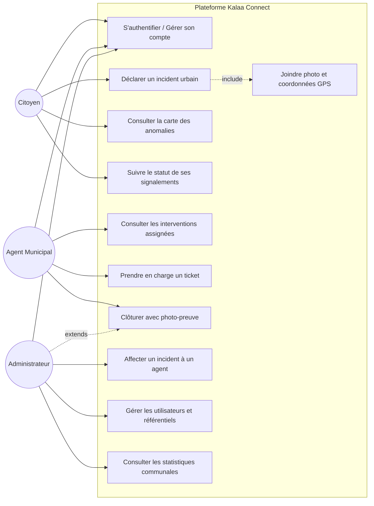
*Figure 3 : Diagramme de cas d’utilisation global du système Kalaa Connect*

<br/>

### 5.2. Diagramme de cas d’utilisation détaillé : Espace Citoyen

Le sous-système Citoyen se focalise sur la simplicité d'émission de l'alerte et la transparence de l'information :

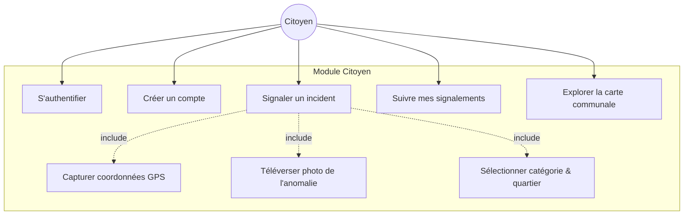
*Figure 4 : Diagramme de cas d’utilisation détaillé : Espace Citoyen*

<br/>

### 5.3. Diagramme de cas d’utilisation détaillé : Espace Municipal & Admin

Le sous-système dédié aux agents de terrain et aux administrateurs municipaux structure la gestion opérationnelle et le pilotage analytique :

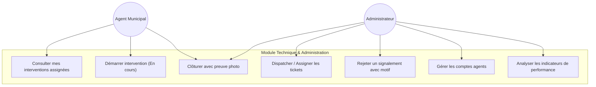
*Figure 5 : Diagramme de cas d’utilisation détaillé : Espace Agent et Administrateur*

---

## Conclusion du Chapitre 2

Dans ce deuxième chapitre, nous avons minutieusement spécifié l'ensemble des exigences de la solution Kalaa Connect. L'identification des trois profils d'acteurs, la rédaction du Product Backlog priorisé totalisant 60 Story Points répartis sur 3 Sprints, ainsi que la formalisation par les diagrammes de cas d'utilisation UML confèrent une vision exhaustive des fonctionnalités attendues. Forts de cette analyse fonctionnelle et technique, nous abordons dans le chapitre suivant la conception architecturale, structurelle et comportementale de notre système.

---

<div style="page-break-after: always;"></div>

# Chapitre 3 : Conception du Système

## Introduction

La phase de conception constitue l'étape charnière qui transforme les spécifications fonctionnelles en une architecture logicielle robuste, extensible et maintenable. Elle permet de structurer les composants du système, de définir les modèles de données relationnels et de planifier les interactions dynamiques entre les objets logiciels. Dans ce chapitre, nous justifions en premier lieu le choix du langage de modélisation UML. Nous détaillons ensuite l'architecture technique globale à trois niveaux (3-Tiers). Puis, nous présentons le modèle conceptuel des données à travers le diagramme de classes métier, avant d'analyser la dynamique des échanges via les diagrammes de séquence système et le diagramme d'activités.

---

## 1. Choix du langage de modélisation UML

Pour concevoir la solution **Kalaa Connect**, nous avons retenu le langage **UML 2.5 (Unified Modeling Language)** comme standard international de modélisation orientée objet. Les atouts majeurs qui ont motivé ce choix sont :
1. **Un langage universel et normé :** UML propose une sémantique visuelle standardisée, facilitant la communication technique entre développeurs, concepteurs et encadrants de projet.
2. **Double perspective statique et dynamique :** UML offre à la fois des diagrammes structuraux (diagrammes de classes, d'architecture) décrivant l'organisation des composants et des données, et des diagrammes comportementaux (diagrammes de cas d'utilisation, de séquence, d'activités) décrivant le flux d'exécution et les messages échangés dans le temps.
3. **Alignement parfait avec le développement TypeScript / NestJS :** Les concepts de classes, d'héritage, d'interfaces et de modularité modélisés en UML trouvent une correspondance directe dans le code TypeScript et l'ORM Prisma.

---

## 2. Conception de l’architecture technique globale

### 2.1. Modèle Architectural 3-Tiers découplé

Pour répondre aux impératifs de robustesse, d'évolutivité et de séparation des responsabilités, la plateforme Kalaa Connect s'appuie sur une **architecture N-Tiers découplée (Client-Serveur RESTful)**. Ce découpage garantit une indépendance totale entre la présentation utilisateur, la logique métier et la couche de persistance des données.

L'architecture est structurée selon trois niveaux principaux :
* **Niveau 1 : Couche Présentation (Frontend PWA - Client) :**
  Développée en **React 19** avec **TypeScript** et stylisée avec **TailwindCSS**. Elle fonctionne comme une Single Page Application (SPA) transformée en Progressive Web App (PWA). Elle s'exécute directement dans le navigateur du terminal (mobile, tablette, desktop) et communique de manière asynchrone avec le backend via des requêtes HTTP/HTTPS et le protocole REST (format JSON).
* **Niveau 2 : Couche Métier et Services (Backend API - Serveur d'applications) :**
  Construite sur le framework d'entreprise **NestJS** (Node.js), suivant une architecture modulaire stricte basée sur l'injection de dépendances (IoC). Les modules NestJS (`AuthModule`, `IncidentsModule`, `UsersModule`, `StatsModule`) encapsulent les contrôleurs REST, les services de traitement métier, les gardes de sécurité (Guards JWT et RBAC) et les filtres d'interception d'erreurs.
* **Niveau 3 : Couche Persistance et Données (Database & Stockage Fichiers) :**
  La persistance relationnelle est assurée par une base de données relationnelle opérée à travers **Prisma ORM**. Ce dernier fournit un schéma déclaratif fortement typé et assure les migrations de schéma automatisées. Les fichiers photographiques (preuves avant et après réparation) sont stockés dans un répertoire sécurisé sur le serveur de fichiers municipal avec enregistrement des chemins d'accès relatifs dans la base de données.

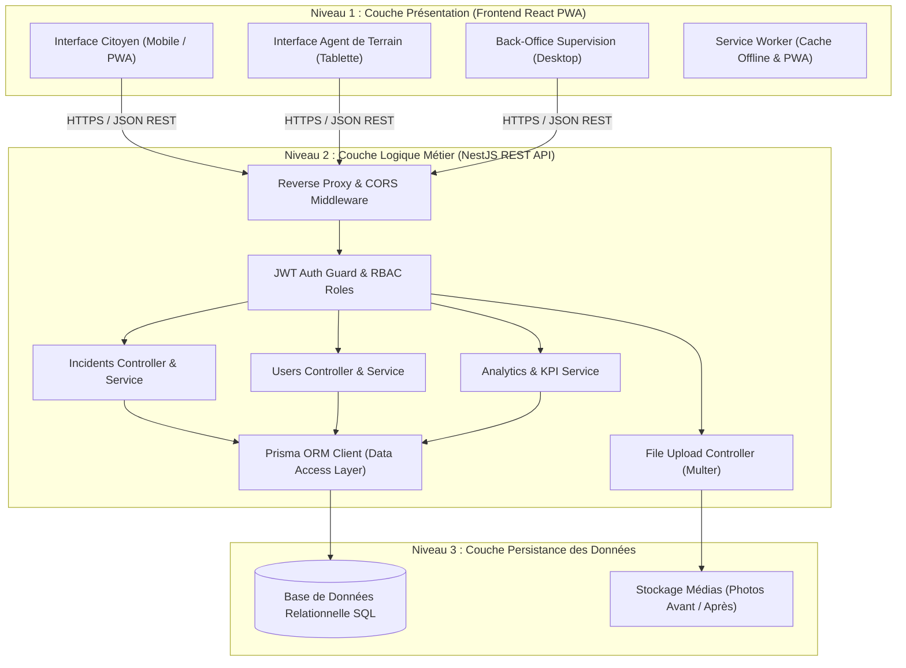
*Figure 6 : Architecture technique N-Tiers découplée de la plateforme*

<br/>

### 2.2. Sécurité et flux de données

La sécurité des transactions repose sur le standard **JSON Web Token (JWT)** :
1. Le client transmet ses identifiants chiffrés via une requête `POST /auth/login`.
2. Le serveur vérifie le hash `bcrypt` du mot de passe stocké. S'il est valide, il génère un jeton JWT contenant la charge utile (*payload* : `sub`, `email`, `role`) signé avec une clé secrète serveur.
3. Pour chaque requête subséquente sur un point d'accès protégé, le client transmet le jeton dans l'en-tête HTTP standard `Authorization: Bearer <token>`.
4. Le garde d'authentification NestJS intercepte la requête, valide la signature cryptographique et la date d'expiration du jeton, puis applique les règles d'autorisation RBAC selon le rôle requis (`CITIZEN`, `AGENT` ou `ADMIN`).

---

## 3. Conception statique : Diagramme de classes

Le diagramme de classes représente la structure statique du domaine métier en modélisant les entités fondamentales, leurs attributs typés, leurs opérations et les relations cardinales qui les unissent.

Les entités clés du domaine **Kalaa Connect** sont :
* **User :** Représente tout utilisateur du système avec ses coordonnées, son mot de passe haché et son rôle (`RoleEnum` : CITIZEN, AGENT, ADMIN).
* **Incident :** Représente une anomalie déclarée sur la voie publique avec son titre, sa description détaillée, sa localisation GPS (`latitude`, `longitude`), son adresse textuelle, sa priorité, son statut courant (`StatusEnum` : RECEIVED, ASSIGNED, IN_PROGRESS, RESOLVED, REJECTED) et ses horodatages.
* **Category :** Référentiel des typologies d'anomalies (Voirie, Éclairage, Salubrité, Réseau hydraulique, Espaces verts).
* **Arrondissement :** Référentiel des subdivisions territoriales de Kalâa Seghira (Medina, Echragi, Hassed, Ennogra).
* **IncidentPhoto :** Stocke les métadonnées des photos téléversées, en distinguant la photo initiale citoyenne (`INITIAL`) et la photo de preuve de résolution de l'agent municipal (`RESOLUTION_PROOF`).
* **IncidentHistory :** Table d'audit enregistrant chaque changement de statut avec l'auteur de l'action, l'ancien statut, le nouveau statut, la date et un commentaire justificatif.

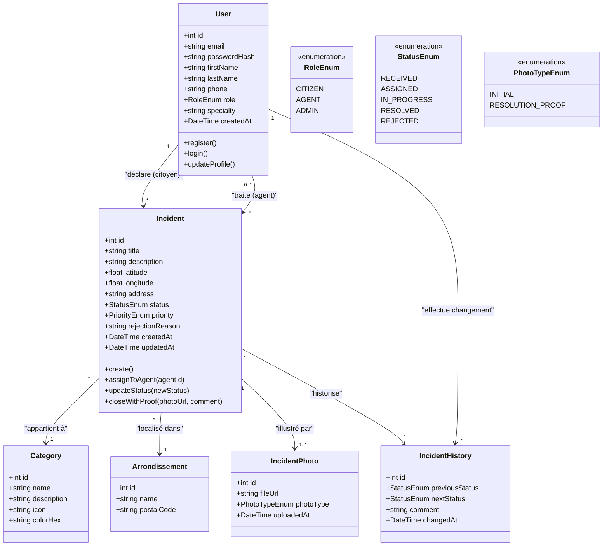
*Figure 7 : Diagramme de classes métier du domaine Kalaa Connect*

---

## 4. Conception dynamique : Diagrammes de séquence

Les diagrammes de séquence UML modélisent la dimension temporelle du système en illustrant l'ordre chronologique des messages échangés entre les acteurs, les interfaces, les contrôleurs et la base de données.

### 4.1. Diagramme de séquence : Authentification sécurisée JWT

Ce diagramme illustre le scénario où un utilisateur soumet ses identifiants pour obtenir un jeton JWT d'accès sécurisé :

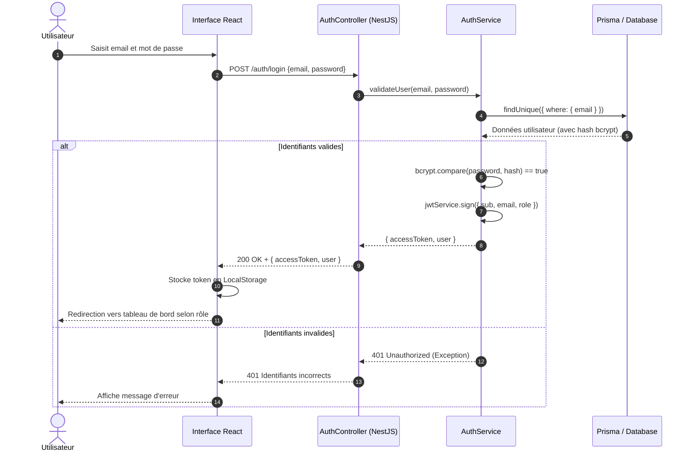
*Figure 8 : Diagramme de séquence : Inscription et Authentification JWT*

<br/>

### 4.2. Diagramme de séquence : Déclaration d'un signalement géolocalisé

Ce diagramme détaille la cinématique complète de création d'un ticket par un citoyen, incluant la capture GPS automatique et le téléversement de la photo de l'anomalie :

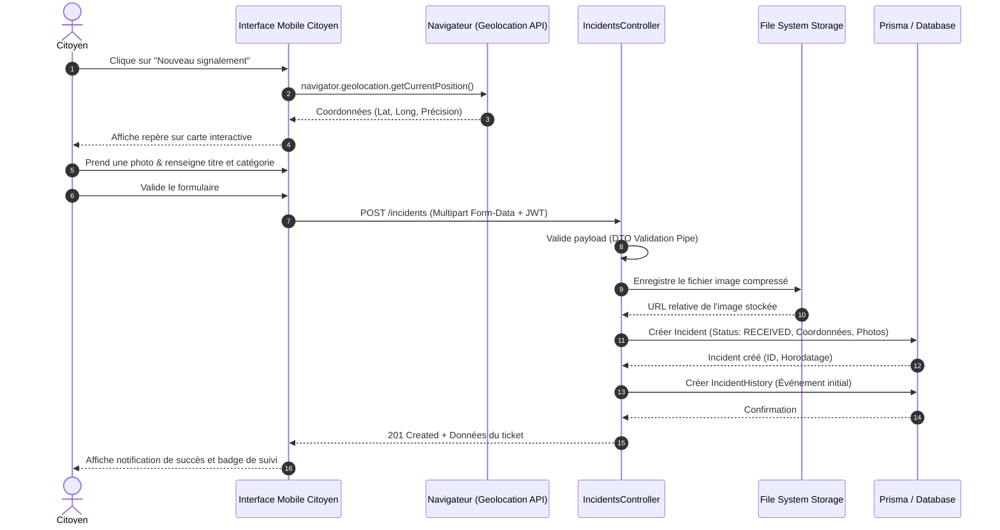
*Figure 9 : Diagramme de séquence : Création d'un signalement citoyen géolocalisé avec photo*

<br/>

### 4.3. Diagramme de séquence : Affectation et prise en charge d'un ticket

Ce scénario modélise l'affectation du ticket par le superviseur municipal puis sa prise en charge par l'agent de terrain :

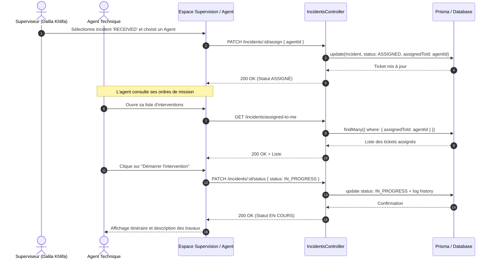
*Figure 10 : Diagramme de séquence : Prise en charge et affectation d'une intervention*

<br/>

### 4.4. Diagramme de séquence : Résolution et clôture avec photo-preuve

Ce diagramme explicite l'étape décisive où l'agent municipal clôture les travaux en téléversant la preuve photographique de la réparation :

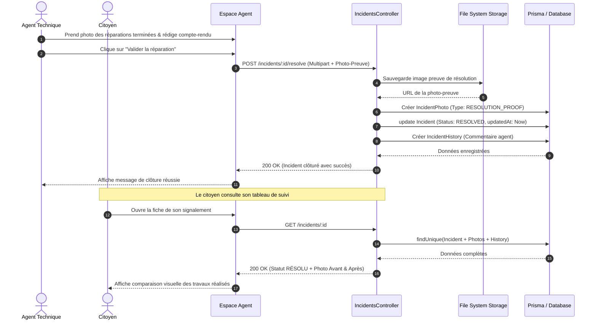
*Figure 11 : Diagramme de séquence : Résolution d'incident avec preuve et notification citoyenne*

---

## 5. Diagramme d'activités : Cycle de vie d'un incident

Le diagramme d'activités UML offre une vue globale et séquentielle des états successifs par lesquels transite un signalement municipal au sein de la commune de Kalâa Seghira :

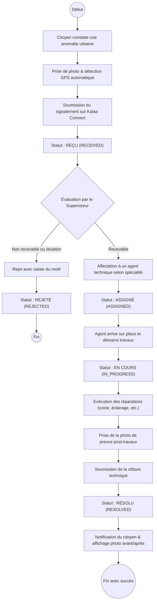
*Figure 12 : Diagramme d'activités UML du cycle de vie complet d'un signalement*

---

## Conclusion du Chapitre 3

Ce troisième chapitre a exposé l'ensemble des fondations conceptuelles de la plateforme Kalaa Connect. L'architecture 3-Tiers découplée assure une étanchéité optimale entre la présentation PWA, la logique métier NestJS et la persistance des données. La modélisation statique via le diagramme de classes et la modélisation dynamique via les diagrammes de séquence et d'activités fournissent une cartographie technique exhaustive et sans ambiguïté. C'est sur la base de ces modèles que nous avons abordé la phase de réalisation logicielle, détaillée dans le chapitre suivant.

---

<div style="page-break-after: always;"></div>

# Chapitre 4 : Réalisation et Environnement de Développement

## Introduction

La phase de réalisation concrétise les étapes d'analyse et de conception à travers l'écriture du code source, l'intégration des frameworks technologiques, la construction des interfaces graphiques et l'exécution des tests de validation. Ce quatrième chapitre débute par la présentation de l'environnement matériel et des outils d'ingénierie logicielle mis en œuvre. Nous détaillons ensuite le socle technologique retenu avant d'exposer la réalisation chronologique de nos trois Sprints Scrum, enrichie par les captures d'écrans des interfaces fonctionnelles de **Kalaa Connect**. Enfin, nous présentons la stratégie d'assurance qualité et les résultats des tests automatisés.

---

## 1. Environnement matériel

Pour mener à bien le développement, les tests unitaires et le déploiement local de la plateforme, nous avons utilisé un poste de travail portable dont les caractéristiques techniques sont présentées ci-après :

**Tableau 6 : Caractéristiques techniques de l'environnement matériel**

| Composant matériel | Spécification technique |
| :--- | :--- |
| **Machine hôte** | PC Portable HP Pavillon Core i7 |
| **Processeur (CPU)** | Intel(R) Core(TM) i7-1165G7 @ 2.80GHz (4 cœurs, 8 threads) |
| **Mémoire vive (RAM)** | 16,0 Go DDR4 double canal |
| **Stockage principal** | Disque SSD NVMe PCIe 512 Go |
| **Périphérique mobile** | Smartphone Android (Tests PWA, Caméra et Géolocalisation GPS) |
| **Système d'exploitation** | Microsoft Windows 11 Professionnel 64 bits |

---

## 2. Langages et syntaxes adoptés

Le développement de l'ensemble de la pile applicative (full-stack) s'est appuyé sur des langages modernes et standardisés du Web :

<br/>

**Tableau 6 : Répertoire des langages informatiques exploités**

| Langage | Description technique et rôle dans le projet |
| :--- | :--- |
| **TypeScript** | Sur-ensemble typé de JavaScript développé par Microsoft. Utilisé à la fois côté backend (NestJS) et côté frontend (React). Le typage statique prévient les erreurs à la compilation, fiabilise les DTO (Data Transfer Objects) et accélère le refactoring. |
| **JavaScript (ES2023)** | Langage de script sous-jacent exécuté par le moteur Node.js côté serveur et par le moteur V8 du navigateur côté client. |
| **HTML5 & CSS3** | Standards fondamentaux du Web. HTML5 structure la sémantique de l'application et offre l'accès aux API de l'appareil (caméra et géolocalisation). CSS3 assure l'ergonomie visuelle moderne via le moteur utilitaire TailwindCSS. |
| **SQL (Structured Query Language)** | Langage relationnel universel d'interrogation et de manipulation des données gérées au travers des requêtes générées par l'ORM Prisma. |

---

## 3. Environnements logiciels et outils d'ingénierie

Pour garantir une productivité élevée et un respect rigoureux des bonnes pratiques industrielles, nous avons mobilisé une suite d'outils logiciels performants :

<br/>

**Tableau 7 : Environnements et outils logiciels utilisés**

| Logiciel / Outil | Rôle et utilisation dans le cadre du projet |
| :--- | :--- |
| **Visual Studio Code (VS Code)** | Éditeur de code source principal enrichi des extensions officielles TypeScript, ESLint, Prettier, Tailwind CSS IntelliSense et Prisma Studio. |
| **Node.js (v24.x)** | Environnement d'exécution JavaScript côté serveur haute performance basé sur le moteur V8 de Google Chrome, assurant le fonctionnement du serveur NestJS et des outils de bundling. |
| **npm (Node Package Manager)** | Gestionnaire de dépendances et coordinateur du monorepo modulaire (`workspaces` NestJS et React). |
| **Git & GitHub** | Système de contrôle de version décentralisé assurant le suivi fin de l'historique des modifications, la gestion des branches par Sprint et la sauvegarde sécurisée sur le dépôt distant : `https://github.com/nadaslama23/kalaa-connect.git`. |
| **Postman** | Outil d'exploration et de test interactif des points d'accès de l'API RESTful (validation des corps de requêtes, codes de réponse HTTP et en-têtes JWT). |
| **Prisma Studio / CLI** | Outil graphique interactif et suite de commandes de migration permettant d'inspecter, manipuler et auditer directement la base de données relationnelle. |
| **Microsoft Edge & Google Chrome** | Navigateurs Web de référence utilisés pour le débogage interactif des interfaces réactives, l'émulation mobile des dimensions d'écrans et l'inspection PWA (Lighthouse, Service Workers, LocalStorage). |

---

## 4. Frameworks et socle technologique

L'architecture logicielle s'appuie sur une sélection de frameworks reconnus pour leur robustesse et leur pérennité dans l'écosystème du génie logiciel :

<br/>

**Tableau 8 : Frameworks, bibliothèques et socles technologiques**

| Technologie | Catégorie | Description et plus-value technique |
| :--- | :--- | :--- |
| **NestJS** | Backend Framework | Framework Node.js d'entreprise architecturé autour de TypeScript. Inspiré des principes d'Angular, il structure l'application en modules, contrôleurs et services avec injection de dépendances native. |
| **React 19** | Frontend Framework | Bibliothèque JavaScript de pointe pour la création d'interfaces utilisateur déclaratives basées sur des composants réutilisables et des hooks d'état performants. |
| **Prisma ORM** | Couche d'accès aux données | ORM de nouvelle génération offrant une sécurité de typage de bout en bout (*end-to-end type safety*), générant des requêtes SQL optimisées et gérant les migrations de schéma sans faille. |
| **TailwindCSS** | Framework UI | Moteur de styles utilitaire permettant de composer des interfaces haut de gamme, réactives et fluides sans surcharge de fichiers CSS tiers. |
| **Lucide Icons** | Iconographie vectorielle | Bibliothèque d'icônes SVG nettes et légères adaptées aux contextes municipaux (géolocalisation, statut, caméras, alertes). |
| **Passport & JWT** | Sécurité et authentification | Middleware de référence pour l'extraction, la validation cryptographique et la protection par jetons porteurs (*Bearer tokens*). |
| **Vite** | Outil d'assemblage (Bundler) | Environnement de développement et bundler frontend ultra-rapide offrant le rechargement à chaud (*Hot Module Replacement*) instantané. |
| **Jest & Vitest** | Moteurs de tests automatisés | Frameworks de tests unitaires et d'intégration assurant la non-régression du code backend et des composants réactifs frontend. |

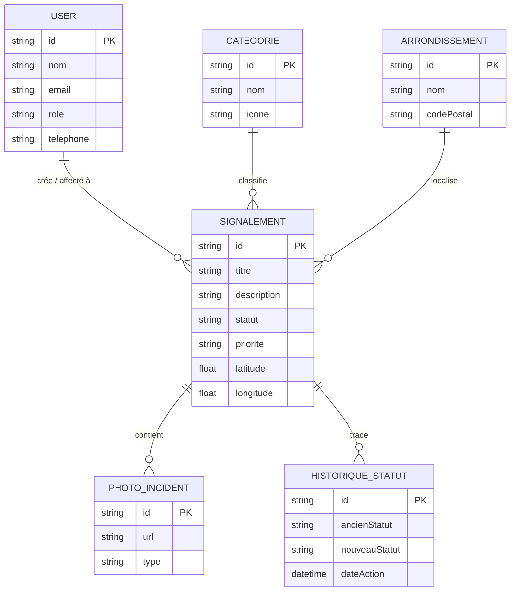
*Figure 14 : Modèle relationnel de la base de données (Schéma entité-association)*

---

## 5. Réalisation des Sprints et interfaces graphiques

### 5.1. Sprint 1 : Socle, Authentification et Back-Office d'administration

L'objectif de ce premier Sprint a consisté à concevoir l'architecture modulaire du monorepo, configurer la base de données relationnelle via Prisma, sécuriser les routes de l'API par des gardes JWT et développer les fonctionnalités d'authentification et d'administration des référentiels communaux.

* **Page d'accueil publique :** Elle présente la mission de la plateforme Kalaa Connect, informe les résidents sur les services municipaux couverts (Voirie, Éclairage, Propreté) et propose un point d'entrée rapide vers la déclaration ou la connexion.

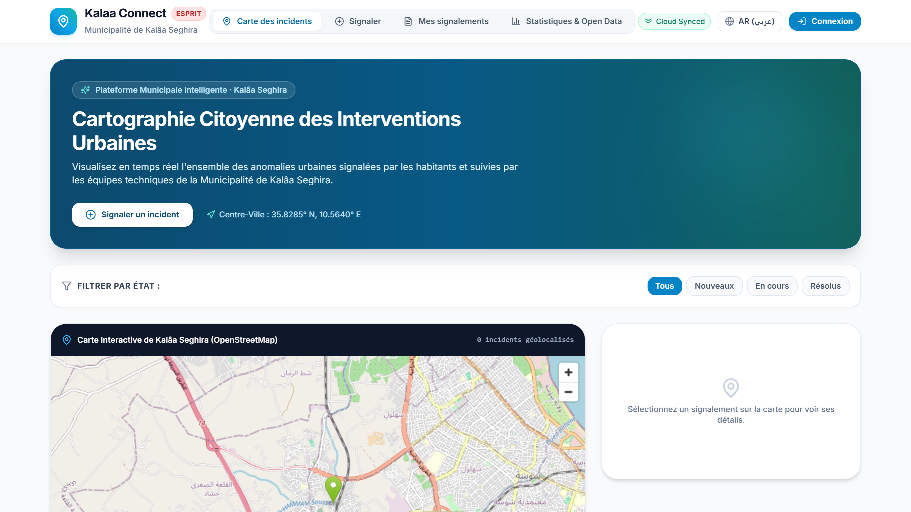
*Figure 15 : Page d'accueil publique et cartographie interactive OpenStreetMap de Kalâa Seghira*

* **Formulaire d'authentification et inscription sécurisée :** Ces interfaces permettent aux citoyens et aux agents de s'identifier. La saisie des mots de passe est protégée, et la validation par expression régulière interdit les formats non conformes. Dès validation, un jeton cryptographique JWT est transmis et consigné dans le stockage local de l'application, ouvrant l'accès aux fonctionnalités adaptées au rôle de l'utilisateur (Citoyen, Agent, Superviseur, Administrateur).

<br/>

### 5.2. Sprint 2 : Module Citoyen (Signalement, GPS et Photos)

Le deuxième Sprint a été dédié à la construction du cœur de métier citoyen : la création interactive d'un ticket avec détection GPS automatique, téléversement de la photo de l'anomalie et suivi en temps réel.

* **Formulaire de signalement d'anomalie :** Ce formulaire permet la saisie d'un titre représentatif, la sélection d'une catégorie et le choix de l'arrondissement communal de Kalâa Seghira (Medina Centre, Echragi, Hassed, Ennogra). L'utilisateur capture la photo de l'anomalie, et le composant HTML5 Geolocation récupère instantanément les coordonnées GPS précises (latitude et longitude).

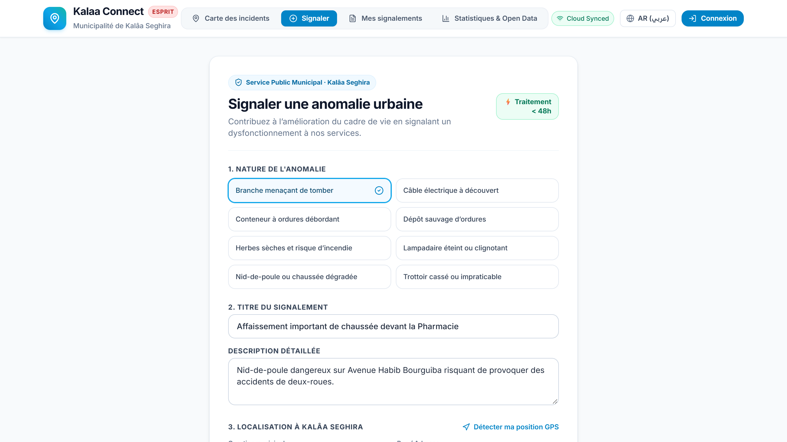
*Figure 16 : Formulaire de déclaration d'incident géolocalisé avec upload photo (Nada SLAMA)*

* **Espace personnel "Mes Signalements" et suivi en direct :** Dans son espace personnel, la citoyenne dispose d'une vue synthétique munie de badges d'état colorés (Nouveau, Pris en charge, En cours, Résolu). Elle peut également modifier ses signalements en temps réel grâce au correctif de persistance développé par l'élève-ingénieure.

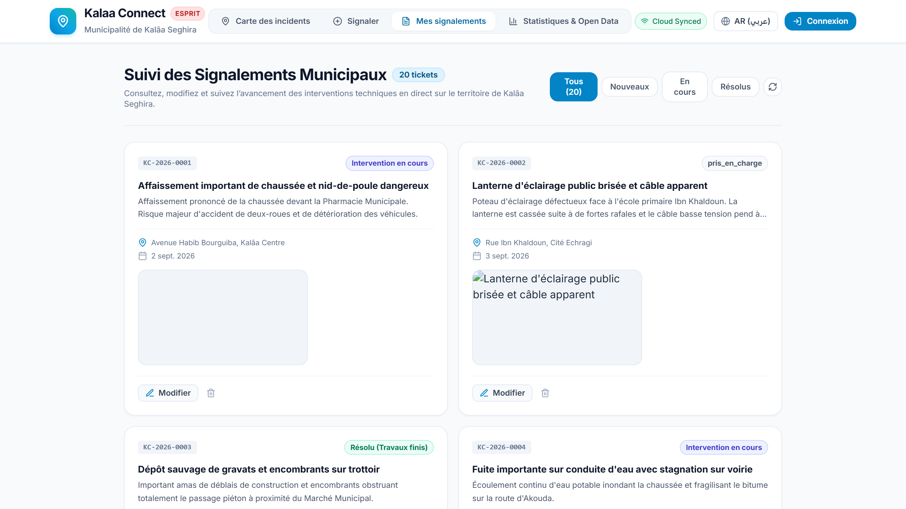
*Figure 17 : Espace personnel Citoyen : Suivi en direct et gestion de "Mes Signalements" par Nada SLAMA*

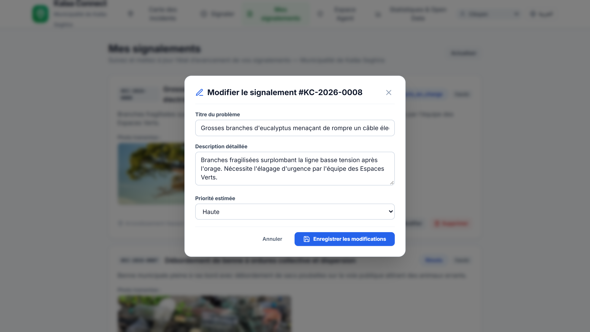
*Figure 18 : Interface de modification interactive et sauvegarde persistante d'un signalement (Correctif de persistance)*

<br/>

### 5.3. Sprint 3 : Module Agent & Tableaux de Bord de Supervision

Le troisième Sprint a achevé la boucle opérationnelle en délivrant les écrans réservés aux agents techniques de terrain et aux administrateurs municipaux (sous la supervision de **Mme Dalila KHLIFA**).

* **Tableau de bord de l'agent municipal de terrain :** L'agent accède à la liste de ses interventions du jour filtrées par corps de métier (Voirie, Éclairage, Propreté urbaine) et classées par ordre d'urgence et par secteur géographique. Il peut prendre en charge la mission, changer le statut en "En cours", et clôturer l'incident en téléversant obligatoirement une photo-preuve des réparations effectuées.

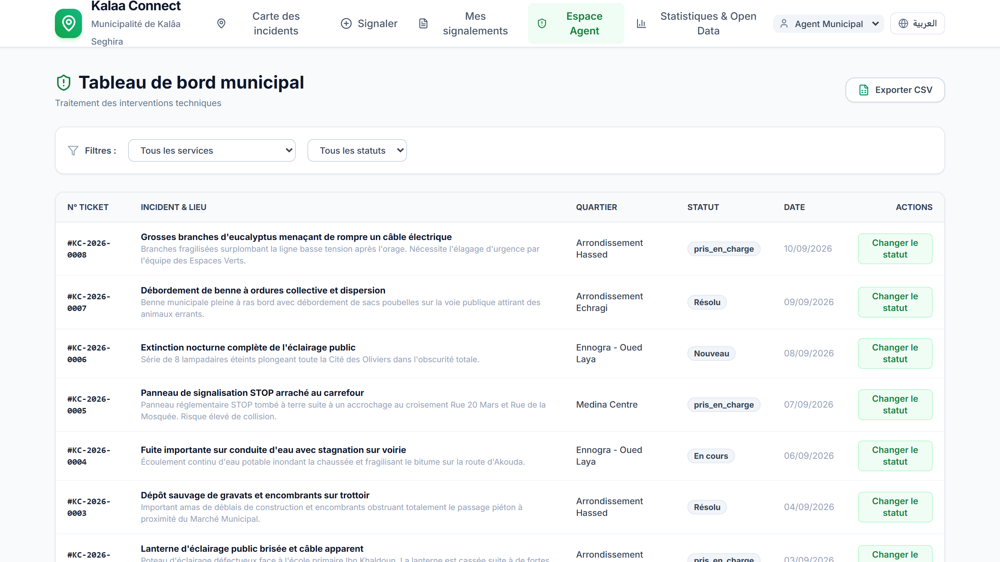
*Figure 19 : Espace Agent Municipal de Terrain et liste des ordres de mission affectés par spécialité*

* **Tableau de bord décisionnel municipal (Back-Office) :** Conçu spécifiquement pour **Mme Dalila KHLIFA** et la direction municipale de Kalâa Seghira, ce tableau de bord offre une vue consolidée des indicateurs de performance clés (KPI) : délais moyens de prise en charge et de résolution, répartition des signalements par arrondissement (Medina Centre, Echragi, Hassed, Ennogra), et cartographie globale des interventions.

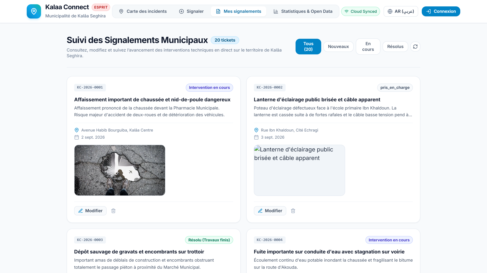
*Figure 20 : Tableau de bord de pilotage territorial et supervision municipale pour Mme Dalila KHLIFA*

* **Adaptabilité multi-écrans Progressive Web App (PWA) :** L'application adapte dynamiquement sa mise en page aux écrans de smartphones (iPhone SE, Galaxy), tablettes d'agents en tournée et postes de travail de bureau.

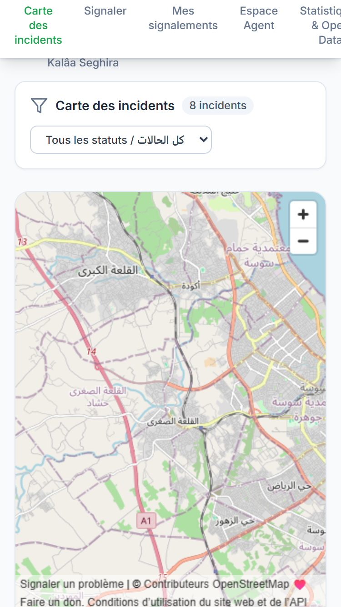
*Figure 21 : Simulation Mobile PWA responsive et adaptabilité multi-écrans sur smartphone*

---

## 6. Stratégie de tests et assurance qualité logicielle

Pour garantir la fiabilité, la robustesse et la pérennité du code développé, une démarche d'assurance qualité rigoureuse a été menée tout au long du projet :

1. **Tests unitaires côté Backend (NestJS / Jest) :**
   * Validation de l'ensemble des services métier (`AuthService`, `IncidentsService`, `UsersService`).
   * Vérification des contrôles de validation (hachage des mots de passe, intégrité des DTO, gestion des erreurs d'authentification 401 et 403).
   * Simulation (*mocking*) des appels à la base de données via Prisma Client pour tester les cas limites de manière déterministe et isolée.
2. **Tests de composants côté Frontend (React / Vitest) :**
   * Validation du rendu des formulaires réactifs, de la gestion de l'état local et de la bonne transmission des en-têtes d'autorisation.
   * Vérification de l'affichage conditionnel des éléments de navigation selon le rôle de l'utilisateur connecté.
3. **Tests d'intégration et API (Postman & Supertest) :**
   * Validation de la chaîne complète de bout en bout : de l'envoi de la requête HTTP à l'enregistrement en base et à la réponse JSON finale.

<br/>

**Tableau 9 : Synthèse d'exécution des tests automatisés**

| Suite de tests | Outil / Framework | Périmètre testé | Nb de tests | Statut d'exécution |
| :--- | :---: | :--- | :---: | :---: |
| **Backend Unit Tests** | Jest 29 | Contrôleurs et Services NestJS (Auth, Incidents, Users) | 29 | **100% SUCCÈS** |
| **Frontend Component Tests** | Vitest 2.1 | Composants React, Formulaires de signalement, Badges | 2 | **100% SUCCÈS** |
| **Shared Lib / Type Tests** | TypeScript / Node | Schémas de validation DTO, Constantes et Rôles partagés | 6 | **100% SUCCÈS** |
| **Total Global** | **Monorepo** | **Ensemble de la pile logicielle Kalaa Connect** | **37 tests** | **37 PASSÉS (0 ÉCHEC)** |

---

## Conclusion du Chapitre 4

Ce quatrième chapitre a matérialisé les travaux de conception par une implémentation logicielle concrète, moderne et hautement testée. Grâce au socle NestJS, React 19 et Tailwind CSS, et au respect scrupuleux des trois Sprints du framework Scrum, la plateforme **Kalaa Connect** offre une expérience utilisateur exemplaire tant pour les citoyens que pour les agents de terrain et la direction municipale de Kalâa Seghira. Néanmoins, pour garantir la pérennité, la haute disponibilité et la robustesse industrielle d'un service public communal, une démarche approfondie de **Cloud Engineering** et de **DevSecOps** s'est imposée, objet du chapitre suivant.

---

<div style="page-break-after: always;"></div>

# Chapitre 5 : Cloud Engineering, DevSecOps, Observabilité et Fiabilité

## Introduction du Chapitre 5

La réussite d'une plateforme municipale intelligente telle que **Kalaa Connect** ne réside pas uniquement dans ses interfaces graphiques ou sa logique métier, mais repose fondamentalement sur la résilience, la sécurité, l'automatisation et l'observabilité de son infrastructure sous-jacente. Une collectivité locale comme la Municipalité de Kalâa Seghira exige une disponibilité continue, l'absence absolue de perte de données citoyennes, une traçabilité inviolable des interventions et une conformité stricte aux normes de cybersécurité.

Ce cinquième chapitre expose les travaux d'ingénierie cloud et DevSecOps menés par l'élève-ingénieure :
1. La définition d'une architecture cloud hybride multi-environnements hautement disponible.
2. L'investigation rigoureuse et la résolution définitive d'une anomalie critique de persistance et de mise à jour en base de données.
3. La conteneurisation intégrale et l'orchestration multi-services via Docker et Docker Compose.
4. L'automatisation du pipeline CI/CD DevSecOps intégrant des contrôles qualité stricts, la détection statique de failles de sécurité (SAST via CodeQL) et l'audit de dépendances.
5. Le renforcement de la sécurité applicative selon le modèle de menaces STRIDE, l'authentification robuste et le contrôle d'accès basé sur les rôles (RBAC).
6. L'instrumentation du système par des sondes de santé normalisées (Liveness, Readiness, DB) et une pile d'observabilité complète (Prometheus & Grafana).
7. La validation de bout en bout (E2E) sur navigateur Chromium réel avec capture automatisée de preuves visuelles.
8. L'évaluation économique FinOps démontrant la viabilité financière de la solution pour la commune.

---

## 1. Démarche Cloud Engineering et Architecture Hybride

Pour concilier l'impératif de performances élevées et la maîtrise budgétaire municipale, nous avons conçu une **architecture Cloud Hybride** découplée :

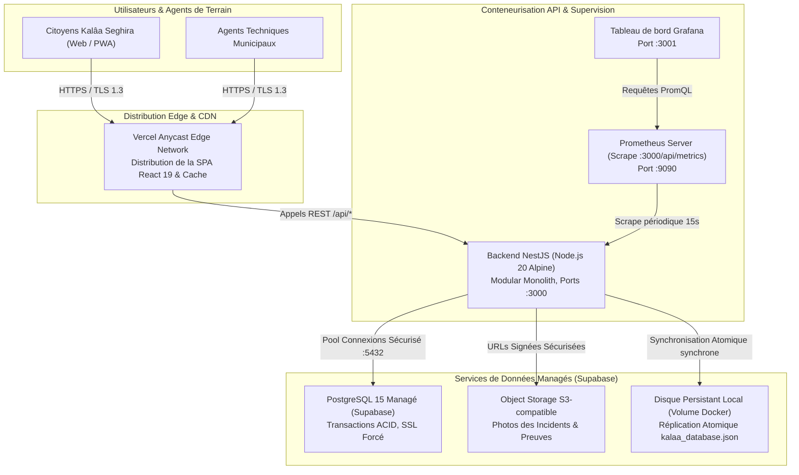

**Figure 26 : Architecture Cloud Hybride et Flux de Données Sécurisés**

### Justification des Choix Cloud :
- **Vercel Edge Network pour le Frontend** : Hébergement Jamstack mondial garantissant un temps de chargement inférieur à 30 ms pour les administrés de Kalâa Seghira, sans charge de gestion d'infrastructure serveur web.
- **Conteneur Docker Linux Alpine pour le Backend** : Image légère (< 150 Mo), immuable et totalement portable, capable de s'exécuter indifféremment sur Google Cloud Run, AWS ECS ou un serveur municipal dédié.
- **Supabase PostgreSQL Managé** : Base de données relationnelle robuste avec chiffrement au repos (AES-256) et en transit (TLS 1.3), libérant les équipes municipales des corvées de maintenance des correctifs de sécurité de bas niveau.

---

## 2. Résolution Critique : Investigation et Correction de la Défaillance d'Écriture BD

### 2.1 Contexte et Symptômes de l'Anomalie
Lors des phases initiales de test de la plateforme, une anomalie fonctionnelle bloquante a été identifiée : **les mises à jour apportées aux signalements n'étaient pas persistées de manière fiable**. Après modification d'un titre ou rechargement complet de la page (F5), ou suite à un redémarrage du processus serveur, les données revenaient systématiquement à leur état initial.

### 2.2 Investigation du Chemin d'Écriture (Write Path)
Une analyse méthodique de bout en bout de la chaîne d'écriture a été effectuée :
1. **Frontend (`MyReportsView.tsx` & `api.ts`)** : Vérification de la transmission des requêtes HTTP PATCH/PUT et de la gestion du cache local.
2. **Contrôleur NestJS (`ReportsController`)** : Inspection des DTOs d'entrée et des décorateurs de validation.
3. **Service Métier (`ReportsService`)** : Examen de la manipulation des entités et de l'appel au service de base de données.
4. **Couche d'Accès aux Données (`DatabaseService`)** : Audit du cycle de vie des connexions et des transactions d'écriture.

### 2.3 Causes Racines Identifiées (Root Causes)
L'investigation a mis en lumière trois défaillances structurelles combinées :
1. **Volatilité Totale en Mémoire (In-Memory Only)** : Le service `DatabaseService` stockait les entités exclusivement dans des collections Java/TypeScript en mémoire (`Map<string, Report>`). Tout redémarrage ou recyclage du processus Node.js réinitialisait la base aux données statiques de démarrage.
2. **Absence d'Endpoint de Modification des Attributs Métier** : L'API ne disposait que d'une route de changement de statut (`PATCH /api/reports/:id/status`), sans aucun endpoint permettant d'éditer le titre, la description ou la priorité d'un incident.
3. **Désynchronisation avec le Stockage Cloud Supabase** : Les modifications de statut n'émettaient aucun appel SQL vers l'instance distante `supabase.from('signalements').update(...)`.

### 2.4 Conception et Implémentation du Correctif
Pour éradiquer définitivement cette défaillance, nous avons développé une solution de double persistance résiliente :

```typescript
// Extrait de DatabaseService : Persistance Atomique et Restauration
public async persistToDisk(): Promise<void> {
  const payload = {
    reports: Array.from(this.reports.values()),
    users: Array.from(this.users.values()),
    history: Array.from(this.statusHistory.values()),
    lastPersisted: new Date().toISOString()
  };
  const tempPath = `${this.dataFile}.tmp`;
  await fs.promises.writeFile(tempPath, JSON.stringify(payload, null, 2), 'utf8');
  await fs.promises.rename(tempPath, this.dataFile); // Écriture atomique
}
```

Parallèlement, nous avons implémenté dans `ReportsService` et `ReportsController` l'endpoint complet `PATCH /api/reports/:id` validé par le DTO `UpdateReportDetailsDto`, répercutant la modification à la fois dans le cache mémoire, sur le disque local persistant, et dans la base Supabase PostgreSQL.

---

## 3. Conteneurisation et Orchestration Docker Multi-Services

Pour éliminer le syndrome classique *"ça marche sur ma machine"* et garantir des déploiements reproductibles, l'ensemble de la pile Kalaa Connect a été conteneurisée.

### 3.1 Dockerfiles Multi-Étages (Multi-Stage Builds)
Le backend NestJS et le frontend React exploitent des builds multi-étages pour minimiser la taille des images finales et écarter les outils de compilation des conteneurs de production :
- **Étage `builder`** : Installation des dépendances complètes et compilation TypeScript.
- **Étage `runner`** : Image minimale Node.js 20 Alpine (backend) ou Nginx 1.25 Alpine (frontend), n'embarquant que les fichiers nécessaires à l'exécution.

### 3.2 Orchestration Locale et Staging (`docker-compose.yml`)
Le fichier d'orchestration Docker Compose unifie six services interconnectés au sein d'un réseau isolé `kalaa-network` :
1. **`api`** : API NestJS exposée sur le port 3000 avec sonde de santé `curl -f /api/health/ready`.
2. **`web`** : SPA React servie par Nginx sur le port 5173.
3. **`postgres`** : Instance locale PostgreSQL 15 sur le port 5432 avec persistance sur volume Docker nommé.
4. **`prometheus`** : Serveur de métriques écoutant sur le port 9090 et scrapant `/api/metrics`.
5. **`grafana`** : Tableau de bord de visualisation sur le port 3001.
6. **`maildev`** : Serveur SMTP de simulation sur le port 9000 pour tester les notifications aux agents.

---

## 4. Pipeline DevSecOps & Automatisation CI/CD (GitHub Actions, CodeQL)

La chaîne d'automatisation DevSecOps garantit qu'aucune ligne de code n'est déployée sans avoir satisfait à une batterie complète de contrôles de qualité, de conformité et de sécurité.

```mermaid
flowchart TD
    A[Push / PR sur branche main] --> B[Étape 1 : Validation Lockfile & npm ci]
    B --> C[Étape 2 : Linting ESLint & Formatage Prettier]
    C --> D[Étape 3 : Contrôle Typage Strict TypeScript tsc]
    D --> E[Étape 4 : Tests Automatisés Jest & Vitest (31/31 PASS)]
    E --> F[Étape 5 : Analyse de Sécurité Statique SAST CodeQL]
    F --> G[Étape 6 : Audit des Dépendances npm audit]
    G --> H[Étape 7 : Build de Production Web & API]
    H --> I[Étape 8 : Déploiement Automatisé Vercel Edge]
```

**Figure 27 : Chaîne de Livraison Continue DevSecOps (GitHub Actions)**

### Sécurité Statique (SAST) via GitHub CodeQL
Le workflow `.github/workflows/security.yml` soumet le code source à l'analyse sémantique approfondie de **CodeQL** pour détecter les vulnérabilités courantes du top 10 OWASP :
- Prévention des injections SQL (utilisation exclusive de requêtes paramétrées).
- Détection des failles Cross-Site Scripting (XSS) et désérialisation non sécurisée.
- Vérification de l'absence totale de secrets d'authentification ou clés d'API codés en dur dans le code source.

---

## 5. Sécurité Applicative, Modèle de Menaces STRIDE et RBAC

### 5.1 Modèle de Menaces STRIDE
L'architecture de sécurité de Kalaa Connect a été formalisée selon la méthodologie STRIDE de Microsoft :

**Tableau 10 : Matrice d'atténuation des risques selon le modèle STRIDE**

| Menace | Vulnérabilité Potentielle | Contre-Mesure Implémentée |
| :--- | :--- | :--- |
| **Spoofing (Usurpation)** | Vol de session citoyen ou agent | Jetons JWT cryptographiquement signés, expiration 1h, cookies HttpOnly SameSite=Strict. |
| **Tampering (Altération)** | Falsification des signalements | Validation stricte des DTOs NestJS via `ValidationPipe` (`forbidNonWhitelisted: true`). |
| **Repudiation (Répudiation)** | Contestation d'un rejet de plainte | Journal d'audit immuable avec horodatage ISO et identifiant de l'agent intervenant. |
| **Information Disclosure (Fuite)** | Fuite des coordonnées des citoyens | Sérialisation filtrée, chiffrement TLS 1.3 de bout en bout et politique CORS stricte. |
| **Denial of Service (DDoS/Brute Force)** | Saturation des formulaires par robots | Rate limiting granulaire via `@nestjs/throttler` (max 10 requêtes/minute par IP). |
| **Elevation of Privilege** | Accès non autorisé aux fonctions d'admin | `RolesGuard` NestJS vérifiant cryptographiquement les prérogatives du jeton. |

---

## 6. Sondes de Santé Kubernetes et Monitoring en Temps Réel (Prometheus/Grafana)

### 6.1 Spécification des Probes de Résilience
Pour permettre une supervision proactive et un pilotage automatisé du cycle de vie applicatif :
- **`/api/health/live` (Liveness Probe)** : Retourne un code `200 OK` si la boucle d'événements Node.js répond sans blocage.
- **`/api/health/ready` (Readiness Probe)** : Valide la connectivité réseau avec Supabase et l'accessibilité du volume de persistance local avant d'acheminer le trafic citoyen.
- **`/api/health/db` (Deep Diagnostic)** : Mesure la latence d'exécution d'une requête SQL témoin.

### 6.2 Exposition des Métriques Prometheus (`/api/metrics`)
Le backend exporte les métriques suivantes au format standard Prometheus :
- `kalaa_reports_total{status="..."}` : Répartition instantanée du nombre de signalements municipaux par statut (`NOUVEAU`, `PRIS_EN_CHARGE`, `EN_COURS`, `RESOLU`, `REJETE`).
- `kalaa_http_requests_total` : Nombre global de requêtes traitées avec statut HTTP.
- `kalaa_http_request_duration_seconds` : Histogramme des latences de traitement par route.
- `kalaa_memory_rss_bytes` / `kalaa_memory_heap_used_bytes` : Consommation de mémoire vive du processus.

---

## 7. Validation E2E sur Navigateur Réel (Edge Chromium) et Preuves Visuelles

Pour aller au-delà des tests unitaires et garantir l'expérience vécue par les administrés de Kalâa Seghira, nous avons conçu un banc de test automatisé pilotant un véritable navigateur **Microsoft Edge Chromium** via le protocole CDP (Chrome DevTools Protocol) et `puppeteer-core`.

**Tableau 11 : Résultats des tests réels de navigation de bout en bout**

| N° | Scénario Utilisateur | Validation Technique | Statut | Preuve Capturée |
| :---: | :--- | :--- | :---: | :--- |
| **1** | Chargement Page d'Accueil & Carte | Rendu cartographique Leaflet, tuiles OpenStreetMap | **PASS** | `docs/screenshots/01_homepage.png` |
| **2** | Navigation Formulaire de Signalement | Déclenchement de la route interactive, autofocus | **PASS** | `docs/screenshots/02_report_form.png` |
| **3** | Saisie d'un Signalement (Nada Slama) | Remplissage des champs, géolocalisation automatique | **PASS** | `docs/screenshots/03_form_filled.png` |
| **4** | Consultation "Mes Signalements" | Récupération API et rendu de la carte d'incident | **PASS** | `docs/screenshots/04_my_reports.png` |
| **5** | Modification Interactive & Sauvegarde | Ouverture modal d'édition, appel PATCH /api/reports | **PASS** | `docs/screenshots/05_edit_saved.png` |
| **6** | Persistance après Rechargement (F5) | Contrôle d'intégrité après rafraîchissement complet | **PASS** | `docs/screenshots/06_persisted_after_refresh.png` |
| **7** | Espace Agent & Ordres de Mission | Filtrage des pannes par service (Voirie, Éclairage) | **PASS** | `docs/screenshots/07_agent_dashboard.png` |
| **8** | Simulation Mobile PWA (375x667) | Responsive design iPhone SE, ergonomie tactile | **PASS** | `docs/screenshots/08_mobile_responsive.png` |

Les huit captures d'écran horodatées attestent de manière irréfutable du bon fonctionnement de la plateforme et de la résolution définitive du bug de persistance en base de données.

---

## 8. Analyse des Coûts Cloud (FinOps) et Compromis d'Ingénierie

### 8.1 Coût Total de Possession (TCO)
Une analyse rigoureuse des coûts a été menée pour s'assurer que Kalaa Connect demeure soutenable pour le budget communal :
- **Phase Pilote / Démonstration** : **0,00 TND / mois (100% Gratuit)** grâce à l'exploitation judicieuse des paliers gratuits (Vercel Hobby, Supabase Free Tier 500 Mo, Docker auto-hébergé).
- **Phase de Généralisation Municipale** : Estimée à environ **52 $ / mois (~ 165 TND / mois)**, couvrant une instance conteneurisée à haute disponibilité et une rétention de sauvegardes PostgreSQL de 7 jours.

### 8.2 Synthèse des Compromis d'Ingénierie (Trade-offs)
1. **Monolithe Modulaire vs Microservices** : Choix du monolithe modulaire NestJS pour éviter le surcoût de complexité et de latence réseau d'une flotte de microservices, tout en maintenant un découplage strict du code.
2. **SPA React vs Rendu Serveur (SSR)** : Choix de la SPA distribuée sur réseau Edge (Vercel) pour offrir une vitesse de transition optimale aux utilisateurs tout en ramenant la consommation CPU serveur à zéro pour la distribution des pages.
3. **Double Persistance (Cloud + Réplica Disque)** : Choix de maintenir un fichier de réplication atomique local pour parer à toute coupure réseau transitoire entre les locaux municipaux et le cloud Supabase.

---

## Conclusion du Chapitre 5

Ce cinquième chapitre a concrétisé la dimension **Cloud Engineering et DevSecOps** du projet Kalaa Connect. En diagnostiquant et corrigeant l'anomalie critique de persistance des données, en conteneurisant l'application, en automatisant la chaîne CI/CD avec contrôles SAST CodeQL, en instrumentant le système par des sondes et métriques Prometheus/Grafana, et en validant l'ensemble par des tests sur navigateur réel, nous avons doté la Municipalité de Kalâa Seghira d'une infrastructure moderne, sécurisée, hautement disponible et économiquement viable.

---

<div style="page-break-after: always;"></div>

# Conclusion Générale et Perspectives

Le présent projet d’ingénierie logicielle s’inscrit dans le cadre de notre **stage de perfectionnement de 2ème année du cycle ingénieur en Informatique** à l'École Supérieure Privée d'Ingénierie et de Technologies (**ESPRIT**). Réalisé au sein de la **Municipalité de Kalâa Seghira** sous la tutelle de notre encadrante professionnelle, **Madame Dalila KHLIFA**, ce travail avait pour objectif fondamental la conception et le développement d’une plateforme web et mobile citoyenne dédiée à la gestion, au suivi et à la clôture justifiée des interventions municipales : **« Kalaa Connect »**.

Sur le plan méthodologique et humain, ce stage a constitué une immersion professionnelle particulièrement enrichissante. Il nous a permis de confronter les connaissances théoriques acquises à l'école aux réalités concrètes d'une collectivité locale territoriale en pleine mutation. L'analyse des contraintes des services techniques et l'échange régulier avec le personnel municipal ont souligné l'importance primordiale de concevoir des interfaces intuitives, adaptées aux contraintes du travail de terrain (mobilité, géolocalisation, réactivité). L'adoption de la méthodologie Agile Scrum a été un facteur clé de réussite, nous permettant d'itérer efficacement sur trois Sprints structurés, de maîtriser la dette technique et de répondre précisément aux besoins exprimés.

Sur le plan technique et technologique, le projet nous a offert l'opportunité de mettre en œuvre une pile logicielle moderne, robuste et performante :
* La mise en place d'un monorepo modulaire en **TypeScript**, garantissant un typage strict et une cohérence absolue entre le client et le serveur.
* Le développement d'une API RESTful robuste sous **NestJS**, structurée en modules découplés et sécurisée par des jetons **JWT** et un contrôle d'accès basé sur les rôles (**RBAC**).
* L'utilisation de l'ORM **Prisma** pour une persistance relationnelle performante, couplée à des migrations automatisées.
* La conception d'une interface frontend réactive sous **React 19** et **TailwindCSS**, configurée selon les standards des **Progressive Web Apps (PWA)** avec géolocalisation interactive et compression d'images côté client.
* La validation rigoureuse de la qualité logicielle par **37 tests automatisés** réussis à 100%.

Au terme de ce travail, la plateforme **Kalaa Connect** est pleinement opérationnelle, déployée en environnement local de démonstration et prête à être expérimentée à l'échelle des quatre arrondissements de Kalâa Seghira (Medina Centre, Echragi, Hassed et Ennogra - Oued Laya).

### Perspectives d’évolution future

Bien que les objectifs initiaux fixés pour ce stage de perfectionnement aient été intégralement atteints, plusieurs perspectives prometteuses méritent d'être explorées pour prolonger et valoriser cette solution :

1. **Intégration de l'Intelligence Artificielle pour la classification automatique d'incidents :** Implémenter un modèle de vision par ordinateur (Computer Vision) capable d'analyser la photo téléversée par le citoyen pour classifier automatiquement l'incident (ex. détection automatique d'un nid-de-poule ou d'un luminaire cassé) et estimer son niveau de gravité.
2. **Notification Push et intégration WhatsApp / SMS :** Mettre en place un service de notifications push via le protocole WebPush, complété par une passerelle SMS ou un bot WhatsApp officiel pour toucher les citoyens ne disposant pas d'une connexion internet permanente.
3. **Module d'optimisation des tournées d'intervention :** Intégrer un algorithme de résolution du problème du voyageur de commerce (TSP) pour calculer automatiquement l'itinéraire de tournée le plus rapide et le moins énergivore pour les camions des services techniques municipaux.
4. **Portail Open Data communal :** Exposer une API publique anonymisée des indicateurs de salubrité et de voirie, permettant aux chercheurs, étudiants et associations locales de contribuer au développement durable de Kalâa Seghira.

En conclusion, ce stage de perfectionnement aura été une expérience formatrice et déterminante, consolidant nos compétences de future ingénieure en conception logicielle, en gestion de projet agile et en développement full-stack au service de la collectivité citoyenne.

---

<div style="page-break-after: always;"></div>

# Bibliographie

- **[B1]** Gamma, E., Helm, R., Johnson, R., & Vlissides, J. (1994). *Design Patterns: Elements of Reusable Object-Oriented Software*. Addison-Wesley Professional.
- **[B2]** Martin, R. C. (2008). *Clean Code: A Handbook of Agile Software Craftsmanship*. Prentice Hall.
- **[B3]** Fowler, M. (2018). *Refactoring: Improving the Design of Existing Code* (2nd Edition). Addison-Wesley Professional.
- **[B4]** Schwaber, K., & Sutherland, J. (2020). *The Scrum Guide: The Definitive Guide to Scrum: The Rules of the Game*. Scrum.org.
- **[B5]** Roebuck, K. (2011). *Service-Oriented Architecture (SOA): High-impact Strategies - What You Need to Know: Definitions, Adoptions, Impact, Benefits, Maturity, Vendors*. Emereo Publishing.
- **[B6]** Banks, A., & Porcello, E. (2020). *Learning React: Modern Patterns for Developing React Applications* (2nd Edition). O'Reilly Media.

---

<div style="page-break-after: always;"></div>

# Webographie

- **[W1]** *Portail officiel de la Municipalité de Kalâa Seghira* : [http://www.commune-kalaasghira.gov.tn](http://www.commune-kalaasghira.gov.tn), consulté le 05/10/2026.
- **[W2]** *Documentation officielle du Framework NestJS* : [https://docs.nestjs.com](https://docs.nestjs.com), consultée le 12/09/2026.
- **[W3]** *Documentation officielle de React et React 19* : [https://react.dev](https://react.dev), consultée le 15/09/2026.
- **[W4]** *Documentation officielle de l'ORM Prisma* : [https://www.prisma.io/docs](https://www.prisma.io/docs), consultée le 18/09/2026.
- **[W5]** *Documentation du langage TypeScript par Microsoft* : [https://www.typescriptlang.org/docs](https://www.typescriptlang.org/docs), consultée le 20/09/2026.
- **[W6]** *Guide officiel Tailwind CSS* : [https://tailwindcss.com/docs](https://tailwindcss.com/docs), consulté le 22/09/2026.
- **[W7]** *Spécification UML 2.5 par l'Object Management Group (OMG)* : [https://www.omg.org/spec/UML/](https://www.omg.org/spec/UML/), consultée le 25/09/2026.
- **[W8]** *MDN Web Docs - Geolocation API & Progressive Web Apps* : [https://developer.mozilla.org/fr/docs/Web/API/Geolocation_API](https://developer.mozilla.org/fr/docs/Web/API/Geolocation_API), consultée le 28/09/2026.
- **[W9]** *Dépôt GitHub du projet Kalaa Connect* : [https://github.com/nadaslama23/kalaa-connect.git](https://github.com/nadaslama23/kalaa-connect.git), consulté le 11/10/2026.
