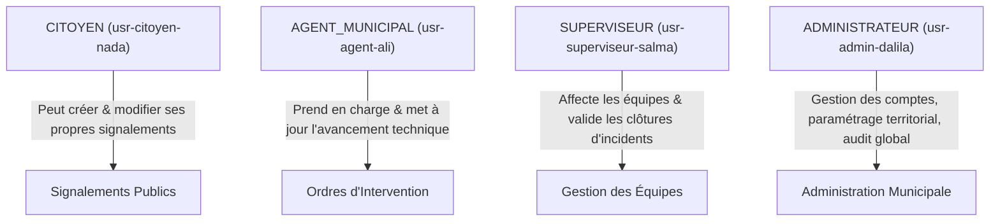

# Sécurité Applicative, Authentification & Conformité — Kalaa Connect

**Projet** : Kalaa Connect  
**Auteure** : Nada SLAMA (Élève-Ingénieure ESPRIT)  
**Encadrante Professionnelle** : Mme Dalila KHLIFA (Municipalité de Kalâa Seghira)  
**Année Universitaire** : 2025–2026  

---

## 1. Modèle de Menaces (STRIDE) & Principes Fondamentaux

Dans le cadre du déploiement d'une plateforme de services publics citoyens, Kalaa Connect met en œuvre une politique de sécurité défensive "Defense-in-Depth" articulée autour du principe du moindre privilège :

| Menace (STRIDE) | Risque Identifié | Mesure de Protection Kalaa Connect |
| :--- | :--- | :--- |
| **Spoofing (Usurpation)** | Vol de session ou usurpation d'identité d'un agent municipal. | JWT signés avec clé secrète forte (HS256/RS256), expiration courte (1h), hachage des mots de passe avec sel cryptographique (Bcrypt / Argon2). |
| **Tampering (Altération)** | Falsification des signalements ou escalade de statut non autorisée. | Validation stricte des DTOs via `ValidationPipe` (`whitelist: true`, `forbidNonWhitelisted: true`). Seuls les agents et superviseurs peuvent changer le statut. |
| **Repudiation (Répudiation)** | Contestation d'une action d'intervention ou d'un rejet de plainte. | Journal d'audit immuable (`audit_log` / `history`) enregistrant l'identifiant de l'auteur, l'ancien statut, le nouveau statut et l'horodatage précis. |
| **Information Disclosure (Fuite)** | Exposition des données personnelles des citoyens (numéro, email). | Masquage des informations sensibles, contrôle strict de sérialisation et restriction CORS sur les domaines approuvés. |
| **Denial of Service (Déni de service)** | Surcharge des formulaires par soumission automatisée de signalements. | Rate Limiting granulaire via `@nestjs/throttler` (limite de 10 requêtes par minute sur la création de signalements). |
| **Elevation of Privilege** | Un citoyen accédant aux prérogatives d'administrateur. | `RolesGuard` obligatoire sur les endpoints sensibles vérifiant le rôle cryptographiquement contenu dans le token. |

---

## 2. Architecture d'Authentification et RBAC

Quatre rôles distincts sont configurés dans la hiérarchie des permissions :

### Règles de Contrôle d'Accès :
- **`GET /api/reports`** : Consultation publique filtrée (citoyens et agents).
- **`POST /api/reports`** : Accessible aux citoyens authentifiés (avec rate-limiting anti-spam).
- **`PATCH /api/reports/:id`** : Accessible à l'auteur du signalement (tant que le statut est `NOUVEAU`) ou aux agents/administrateurs.
- **`PATCH /api/reports/:id/status`** : Réservé exclusivement aux rôles `AGENT`, `SUPERVISEUR` et `ADMIN`.
- **`DELETE /api/reports/:id`** : Réservé à l'auteur ou aux administrateurs municipaux.

---

## 3. En-têtes HTTP de Sécurité & Protection des Données

Le middleware NestJS injecte les en-têtes recommandés par l'ANSSI et l'OWASP :
- **Content-Security-Policy (CSP)** : Empêche l'exécution de scripts tiers non autorisés.
- **Strict-Transport-Security (HSTS)** : Force les navigateurs à utiliser HTTPS exclusivement (`max-age=31536000; includeSubDomains; preload`).
- **X-Content-Type-Options: nosniff** : Empêche le sniffing MIME.
- **X-Frame-Options: DENY** : Protection contre les attaques de type Clickjacking.
- **SameSite=Strict & HttpOnly** : Protection totale des cookies de session contre les attaques XSS.
